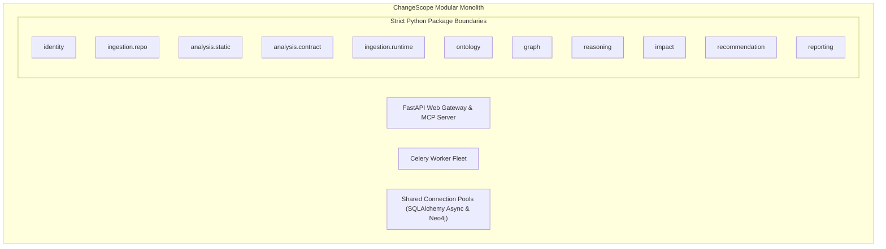

# ADR.md
## ChangeScope: Architectural Decision Records (ADRs)

**Document Version:** 1.0.0  
**Status:** Approved Architectural Decisions  
**Author:** Principal Software Architect & Technical Lead  

---

### Table of Architectural Decision Records

* [ADR-001: PostgreSQL as Canonical Store and Neo4j as Rebuildable Projection](#adr-001-postgresql-as-canonical-store-and-neo4j-as-rebuildable-projection)
* [ADR-002: Modular Monolith Packaging vs. Microservices](#adr-002-modular-monolith-packaging-vs-microservices)
* [ADR-003: Transactional Outbox Pattern for Knowledge Graph Synchronization](#adr-003-transactional-outbox-pattern-for-knowledge-graph-synchronization)
* [ADR-004: Tree-sitter for In-Memory Multi-Language AST Parsing](#adr-004-tree-sitter-for-in-memory-multi-language-ast-parsing)
* [ADR-005: Deterministic Rule Engine vs. LLM for Contract Violation Detection](#adr-005-deterministic-rule-engine-vs-llm-for-contract-violation-detection)
* [ADR-006: NVIDIA Auto Ontology Integration via MCP & Custom Software Ontology](#adr-006-nvidia-auto-ontology-integration-via-mcp--custom-software-ontology)
* [ADR-007: Offline Testability & Zero External API Key Dependency](#adr-007-offline-testability--zero-external-api-key-dependency)
* [ADR-008: Ephemeral tmpfs Workspace with Zero Source Code Retention](#adr-008-ephemeral-tmpfs-workspace-with-zero-source-code-retention)

---

### ADR-001: PostgreSQL as Canonical Store and Neo4j as Rebuildable Projection

#### Status: Accepted

#### Context & Problem Statement
ChangeScope requires persistent storage for multi-tenant accounts, Git commit records, raw schema diffs, scan history, and distributed call graphs. A distributed software dependency graph is inherently a network of nodes and directed edges, making Neo4j ideal for traversal queries. However, graph databases lack mature relational constraints, strict foreign keys, multi-tenant row-level security (RLS), and point-in-time recovery (PITR) tooling compared to modern relational databases.

#### Decision
We designate **PostgreSQL 17 as the single canonical source of truth** for all application state. **Neo4j 5+ is deployed as an asynchronously synchronized, fully rebuildable graph projection**. If the Neo4j instance is corrupted or dropped, it can be re-projected from PostgreSQL event history with zero data loss.

#### Alternatives Rejected
1. **Neo4j as Primary Store:** Rejected because managing multi-tenant RLS, ACID transaction logs for scans, and audit compliance is error-prone and fragile in graph-native engines.
2. **PostgreSQL Only (Recursive CTEs for Graph Queries):** Rejected because recursive SQL queries (`WITH RECURSIVE`) degrade exponentially on deep, multi-hop dependency graphs ($>3$ hops across 50,000 nodes).

#### Consequences & Trade-offs
* **Positive:** Enterprise-grade backup/recovery, strict foreign-key integrity, and zero risk of catastrophic graph data corruption.
* **Negative:** Eventual consistency between PostgreSQL and Neo4j (typically sub-second lag via outbox worker).

#### Failure Scenarios & Mitigations
* *Scenario:* Neo4j database crashes or suffers index corruption.
* *Mitigation:* The `GraphRebuilder` worker executes a deterministic full replay from PostgreSQL to restore graph topology without service downtime for primary scan state.

---

### ADR-002: Modular Monolith Packaging vs. Microservices

#### Status: Accepted

#### Context & Problem Statement
ChangeScope comprises 11 distinct functional domains (Identity, Ingestion, Static Analysis, Contract Analysis, Runtime Evidence, Ontology, Knowledge Graph, Reasoning, Impact, Recommendations, Reporting). Packaging each domain as an independent microservice creates distributed transaction overhead, network serialization latency, independent container orchestration friction, and severe local developer setup pain.

#### Decision
We implement ChangeScope as a **Modular Monolith** in Python 3.12. The application is organized into isolated internal Python packages with strict interfaces. All modules run inside a unified FastAPI process (for APIs) and Celery worker fleet (for background processing), sharing PostgreSQL and Redis connection pools.

#### Alternatives Rejected
* **Microservices Fleet (11 separate containers):** Rejected due to network latency in PR analysis loops, complex distributed tracing, high cloud costs, and operational tax.

#### Consequences & Trade-offs
* **Positive:** Sub-millisecond in-memory function calls, atomic database transactions across domains, simple local Docker Compose setup, and low operational overhead.
* **Negative:** Requires rigorous discipline in CI (linting via `import-linter`) to prevent circular package imports.

---

### ADR-003: Transactional Outbox Pattern for Knowledge Graph Synchronization

#### Status: Accepted

#### Context & Problem Statement
When a scan completes in PostgreSQL, corresponding nodes and edges must be updated in Neo4j. Direct dual-writing from the ingestion worker to both PostgreSQL and Neo4j introduces the "dual-write distributed transaction problem": if the Neo4j write fails or network times out after the PostgreSQL commit, the two datastores drift permanently out of sync.

#### Decision
We implement the **Transactional Outbox Pattern**. Ingestion workers write scan results and append an event to the PostgreSQL `outbox_events` table within a single atomic database transaction. An asynchronous Celery projector worker polls pending outbox events using `SELECT ... FOR UPDATE SKIP LOCKED` and applies idempotent Cypher `MERGE` queries to Neo4j.

#### Consequences & Trade-offs
* **Positive:** Guarantees at-least-once delivery and transactional consistency between relational state and graph projections.
* **Negative:** Sub-second eventual consistency latency between PR completion and graph visualization update.

---

### ADR-004: Tree-sitter for In-Memory Multi-Language AST Parsing

#### Status: Accepted

#### Context & Problem Statement
ChangeScope must parse Python and TypeScript/JavaScript source code to extract route handlers, client HTTP calls, and ORM models. Using full language toolchains (e.g., executing `tsc` or running Python runtime reflection) requires installing language runtimes, compilers, and project dependencies (`npm install`, `pip install`), causing prohibitive 5-10 minute CI delays.

#### Decision
We adopt **Tree-sitter** C/Wasm bindings (`tree-sitter-python`, `tree-sitter-typescript`, `tree-sitter-javascript`). Tree-sitter parses raw source code directly into Concrete Syntax Trees (CST) and ASTs in-memory in milliseconds without requiring compilation, execution, or external dependencies.

#### Consequences & Trade-offs
* **Positive:** Blazing fast parse speeds (>5,000 lines of code/sec); fault-tolerant parsing on syntactically invalid or incomplete code; zero dependency installation required.
* **Negative:** Dynamic string concatenations in URLs require heuristic S-expression patterns or runtime trace fallback.

---

### ADR-005: Deterministic Rule Engine vs. LLM for Contract Violation Detection

#### Status: Accepted

#### Context & Problem Statement
Evaluating whether an API schema change (such as removing an enum value, changing regex patterns, or altering database column types) breaks downstream consumers could theoretically be delegated to an LLM via prompt engineering. However, LLMs are non-deterministic, prone to hallucination, slow (2-5s per evaluation), and cannot guarantee 100% mathematical precision.

#### Decision
We mandate that **all contract violation evaluations and risk scoring are 100% deterministic algorithms** written in pure Python. The rule engine checks formal mathematical constraints (set differences for enums, regex inclusion, JSON Schema validation). **LLMs (via LangGraph) are strictly restricted to narrative formatting, explanation synthesis, and test stub generation**.

#### Consequences & Trade-offs
* **Positive:** Provable mathematical determinism, zero hallucinations on breaking changes, sub-millisecond execution times, and complete auditability.
* **Negative:** New breaking change categories must be authored as explicit algorithmic rules in code.

---

### ADR-006: NVIDIA Auto Ontology Integration via MCP & Custom Software Ontology

#### Status: Accepted

#### Context & Problem Statement
NVIDIA Auto Ontology (`NVIDIA/auto-ontology`) is an enterprise framework designed to generate semantic layers over enterprise relational databases for Text-to-SQL workflows. It lacks native software engineering ontology primitives (AST symbols, OpenAPI endpoints, OTel spans).

#### Decision
We do not adopt `NVIDIA/auto-ontology` as an internal monolithic dependency. Instead, we:
1. Define a native **Software Engineering Ontology** in Neo4j tailored specifically to distributed systems.
2. Integrate with NVIDIA Auto Ontology via its official **Model Context Protocol (MCP)** interface to enrich database table definitions and schema metrics.
3. Expose ChangeScope's graph intelligence tools via an MCP server for external AI agents.

#### Consequences & Trade-offs
* **Positive:** Clean architectural separation of concerns; avoids forcing a Text-to-SQL tool to do source code AST analysis.
* **Negative:** Requires custom engineering of the software engineering graph ontology.

---

### ADR-007: Offline Testability & Zero External API Key Dependency

#### Status: Accepted

#### Context & Problem Statement
Enterprise security policies and automated CI/CD runners often run in air-gapped environments without outbound internet access. Requiring live API keys (NVIDIA NIM, OpenAI, GitHub) to execute unit and integration tests causes flaky builds, security leakage risks, and pipeline failures.

#### Decision
We enforce a **Zero-External-Key Testing Invariant**. The test suite uses **Testcontainers** to spin up ephemeral local instances of PostgreSQL 17, Neo4j 5.20, and Redis 7. All external intelligence and GitHub API calls are abstracted behind interfaces with deterministic offline mock implementations (`OfflineIntelligenceProvider`).

#### Consequences & Trade-offs
* **Positive:** 100% reliable, deterministic, fast test runs without external credentials or network dependencies.
* **Negative:** Maintaining mock adapters alongside live provider adapters.

---

### ADR-008: Ephemeral tmpfs Workspace with Zero Source Code Retention

#### Status: Accepted

#### Context & Problem Statement
Enterprises are unwilling to adopt SaaS developer tools that permanently persist their proprietary source code in third-party databases due to intellectual property leakage risks.

#### Decision
ChangeScope implements an **Ephemeral Workspace Ingestion Policy**. Repositories are cloned shallowly (`--depth=2`) into RAM-backed `tmpfs` directories (`/tmp/workspaces/{tenant_id}/{scan_id}`). Immediately after Tree-sitter extracts AST symbols and metadata, the workspace is wiped and unlinked. Only metadata (symbol names, line numbers, schema paths) is persisted.

#### Consequences & Trade-offs
* **Positive:** High enterprise security posture; eliminates source code data breach liability.
* **Negative:** Subsequent scans of the same repo must perform a fresh shallow git fetch rather than reading from a warm local disk cache.
