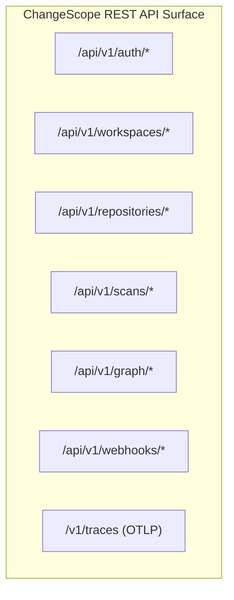
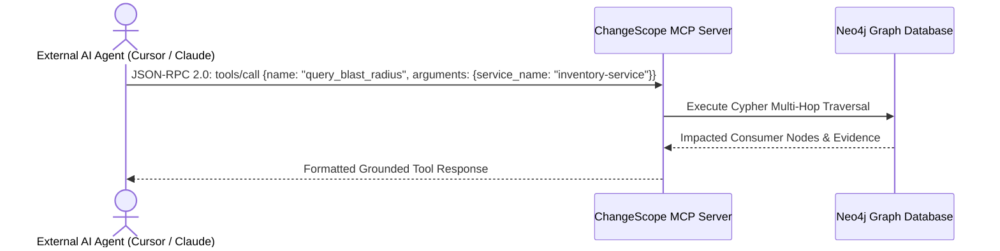

# API_DESIGN.md
## ChangeScope: RESTful & Model Context Protocol (MCP) API Design

**Document Version:** 1.0.0  
**Status:** Approved API Specification  
**Specification Standard:** OpenAPI 3.1 & Model Context Protocol (MCP) 2024-11  

---

### Executive Summary

ChangeScope exposes two primary API surfaces:
1. **RESTful API (OpenAPI 3.1):** High-performance JSON endpoints over HTTPS powering the React 19 SPA, developer CLI, GitHub webhooks, and CI/CD pipelines.
2. **Model Context Protocol (MCP) Server:** Standard JSON-RPC 2.0 interface enabling external AI agents (e.g., Anthropic Claude Desktop, Cursor, LangChain harnesses) to inspect the software knowledge graph with strict grounding.

---

## 1. Global API Conventions & Standards

* **Base URL:** `https://api.changescope.io/api/v1` (Production) / `http://localhost:8000/api/v1` (Local)
* **Content Negotiation:** `Content-Type: application/json`, `Accept: application/json`
* **Authentication:** `Authorization: Bearer <JWT_ACCESS_TOKEN>`
* **Tenant Identification:** Header `X-Tenant-ID: <UUID>` (or inferred from JWT claims)
* **Request Correlation:** Header `X-Request-ID: <UUID>` (generated if absent, propagated across all logs and trace spans)
* **Error Format:** Strict adherence to **RFC 7807 Problem Details for HTTP APIs** (`application/problem+json`).

---

## 2. Standard Error Response Envelope (RFC 7807)

```json
{
  "type": "https://changescope.io/errors/semantic-violation-blocking",
  "title": "Blocking Semantic Violation Detected",
  "status": 422,
  "detail": "Pull Request contains 2 blocking semantic contract violations that will crash downstream consumers.",
  "instance": "/api/v1/scans/c1f7b8e0-4a82-4f3e-9081-123456789abc",
  "invalid_params": [
    {
      "name": "status",
      "reason": "Enum narrowed. Removed values: ['CANCELLED']",
      "json_pointer": "/paths/~1orders/post/requestBody/content/application~1json/schema/properties/status"
    }
  ]
}
```

---

## 3. Core RESTful Endpoints



### 3.1 Authentication & Workspace Management

#### `POST /api/v1/auth/token`
Authenticate with credentials or exchange GitHub OAuth code for a JWT.
* **Request:**
  ```json
  {
    "grant_type": "github_code",
    "code": "e84920bc8f73a1",
    "redirect_uri": "https://app.changescope.io/auth/callback"
  }
  ```
* **Response (HTTP 200 OK):**
  ```json
  {
    "access_token": "eyJhbGciOiJSUzI1NiIs...",
    "token_type": "bearer",
    "expires_in": 3600,
    "refresh_token": "r_98234abcf...",
    "tenant_id": "80084afc-fdd9-4b0f-8aca-cd5a2615bf86"
  }
  ```

#### `GET /api/v1/workspaces/{workspace_id}/repositories`
List monitored microservice repositories within a workspace.
* **Response (HTTP 200 OK):**
  ```json
  {
    "data": [
      {
        "id": "repo-inv-01",
        "name": "inventory-service",
        "clone_url": "https://github.com/acme-corp/inventory-service.git",
        "primary_language": "python",
        "tier": "TIER_1",
        "last_scanned_sha": "7a8b9c0d1e2f3a4b5c6d7e8f9a0b1c2d3e4f5a6b",
        "created_at": "2026-10-01T12:00:00Z"
      }
    ],
    "pagination": {
      "page": 1,
      "page_size": 20,
      "total_count": 48
    }
  }
  ```

---

### 3.2 Change Scans & Intelligence

#### `POST /api/v1/scans`
Trigger an on-demand scan of a commit or pull request.
* **Request:**
  ```json
  {
    "repository_id": "repo-inv-01",
    "base_sha": "main",
    "head_sha": "feature/narrow-order-status",
    "pr_number": 142
  }
  ```
* **Response (HTTP 202 Accepted):**
  ```json
  {
    "scan_id": "c1f7b8e0-4a82-4f3e-9081-123456789abc",
    "status": "QUEUED",
    "created_at": "2026-11-10T17:15:00Z"
  }
  ```

#### `GET /api/v1/scans/{scan_id}`
Retrieve scan status, deterministic risk score, and summary metrics.
* **Response (HTTP 200 OK):**
  ```json
  {
    "scan_id": "c1f7b8e0-4a82-4f3e-9081-123456789abc",
    "status": "COMPLETED",
    "risk_score": 85,
    "risk_level": "HIGH",
    "started_at": "2026-11-10T17:15:02Z",
    "completed_at": "2026-11-10T17:15:34Z",
    "duration_seconds": 32.4,
    "summary": {
      "blocking_violations": 1,
      "warnings": 2,
      "impacted_services_count": 3,
      "transitive_hops_max": 2
    }
  }
  ```

#### `GET /api/v1/scans/{scan_id}/violations`
List all detected semantic contract and database violations.
* **Response (HTTP 200 OK):**
  ```json
  {
    "violations": [
      {
        "id": "viol-9901",
        "rule_code": "RULE_ENUM_NARROWED",
        "severity": "BLOCKING",
        "file_path": "src/api/schemas/order.py",
        "start_line": 42,
        "end_line": 48,
        "json_pointer": "/paths/~1orders/post/requestBody/content/application~1json/schema/properties/status",
        "impacted_service": {
          "id": "srv-checkout",
          "name": "checkout-service",
          "tier": "TIER_1"
        },
        "message": "Enum narrowed. Removed value 'CANCELLED' is actively consumed by 'checkout-service'.",
        "evidence": {
          "removed_values": ["CANCELLED"],
          "observed_trace_id": "4bf92f3577b34da6a3ce929d0e0e4736",
          "consumer_code_reference": "src/clients/inventory_client.ts:L88"
        }
      }
    ]
  }
  ```

#### `GET /api/v1/scans/{scan_id}/blast-radius`
Fetch the complete impacted dependency graph formatted specifically for the `@xyflow/react` frontend visualization.
* **Response (HTTP 200 OK):**
  ```json
  {
    "nodes": [
      {
        "id": "srv-inventory",
        "type": "providerNode",
        "data": {
          "label": "inventory-service",
          "tier": "TIER_1",
          "is_origin": true,
          "risk": "HIGH"
        },
        "position": { "x": 100, "y": 200 }
      },
      {
        "id": "srv-checkout",
        "type": "consumerNode",
        "data": {
          "label": "checkout-service",
          "tier": "TIER_1",
          "hop_distance": 1,
          "is_observed": true,
          "rpm": 12500
        },
        "position": { "x": 400, "y": 150 }
      }
    ],
    "edges": [
      {
        "id": "edge-checkout-to-inv",
        "source": "srv-checkout",
        "target": "srv-inventory",
        "animated": true,
        "label": "POST /api/v1/orders (12.5k RPM)",
        "data": {
          "provenance": "OTEL_TRACE",
          "confidence": 0.95,
          "is_breaking": true
        }
      }
    ]
  }
  ```

---

### 3.3 Webhooks & Telemetry Ingestion

#### `POST /api/v1/webhooks/github`
GitHub App webhook receiver. Validates HMAC signature via `X-Hub-Signature-256`.
* **Headers:** `X-GitHub-Event: pull_request`, `X-Hub-Signature-256: sha256=...`
* **Response (HTTP 202 Accepted):** `{"status": "QUEUED"}`

#### `POST /v1/traces`
Standard OpenTelemetry Protocol (OTLP/HTTP) trace ingestion endpoint. Ingests Protobuf or JSON traces from OTel Collectors.
* **Headers:** `Content-Type: application/x-protobuf` or `application/json`, `X-Tenant-ID: <UUID>`
* **Response (HTTP 200 OK):** `{"partialSuccess": {}}`

---

## 4. Model Context Protocol (MCP) Server Specification

ChangeScope implements an official **Model Context Protocol (MCP)** server over SSE (Server-Sent Events) and JSON-RPC 2.0 at endpoint `/mcp`. This allows external AI assistants and agents to query the software knowledge graph with grounded determinism.



### 4.1 Exposed MCP Tools

| Tool Name | Parameters | Description |
| :--- | :--- | :--- |
| `search_services` | `query: str`, `tier: Optional[str]` | Search for microservices registered in the knowledge graph. |
| `get_endpoint_dependencies` | `service_name: str`, `endpoint_path: str`, `method: str` | Return all direct static and observed runtime consumers of an endpoint. |
| `query_blast_radius` | `service_name: str`, `changed_symbols: list[str]`, `max_depth: int` | Compute the multi-hop transitive blast radius DAG for proposed symbol changes. |
| `explain_violation` | `violation_id: str` | Return the full cryptographic evidence chain (Diff $\rightarrow$ AST $\rightarrow$ OAS $\rightarrow$ OTel Span) for a violation. |

### 4.2 Sample MCP Tool Call & Response

#### Request: `tools/call` (`query_blast_radius`)
```json
{
  "jsonrpc": "2.0",
  "id": 42,
  "method": "tools/call",
  "params": {
    "name": "query_blast_radius",
    "arguments": {
      "service_name": "inventory-service",
      "changed_symbols": ["OrderStatusEnum"],
      "max_depth": 3
    }
  }
}
```

#### Response:
```json
{
  "jsonrpc": "2.0",
  "id": 42,
  "result": {
    "content": [
      {
        "type": "text",
        "text": "### Blast Radius Analysis for `inventory-service`\n- **Impacted Services (Total: 2):**\n  1. `checkout-service` (Direct 1-hop caller, TIER_1, 12,500 RPM, Evidence: OTel Trace ID `4bf92f3577b34da6a3ce929d0e0e4736`)\n  2. `analytics-pipeline` (Transitive 2-hop caller via Kafka channel `orders.events`)\n- **Calculated Risk Score:** `85/100 (HIGH)`\n- **Breaking Contract Violation:** Enum narrowed (`CANCELLED` removed)."
      }
    ]
  }
}
```
