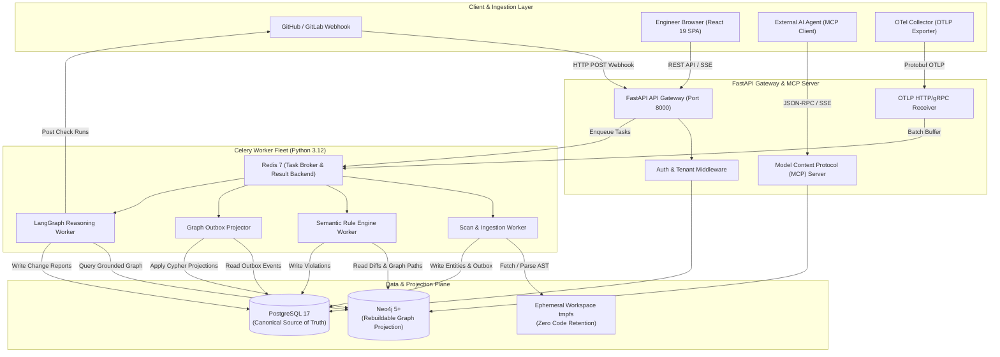
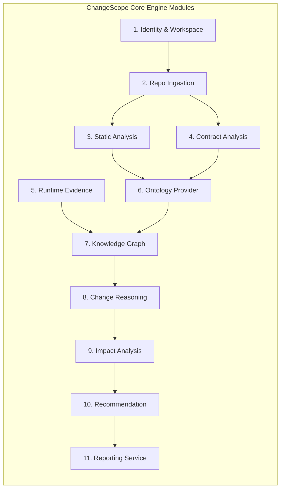
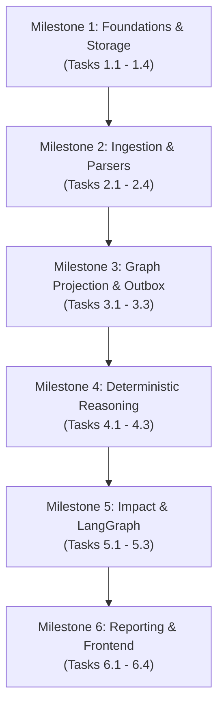

# ARCHITECTURE.md
## ChangeScope: System Architecture & Engineering Blueprint

**Document Version:** 1.0.0  
**Status:** Approved Architectural Blueprint  
**System Classification:** Enterprise Distributed Software Change Intelligence Platform  
**Target Environment:** Local Docker Compose / Kubernetes Production  

---

### Executive Summary

ChangeScope is a semantic change intelligence platform designed to uncover hidden cross-service dependencies, detect breaking contract and database changes, and compute operational blast radius before software changes merge into production.

The platform unifies **static code AST analysis (Tree-sitter)**, **declarative API/event/DB contracts (OpenAPI, AsyncAPI, SQL DDL)**, and **empirical runtime traces (OpenTelemetry)** into a software knowledge graph. ChangeScope enforces uncompromising architectural discipline: **PostgreSQL is the single canonical source of truth**, **Neo4j is an asynchronously synchronized, fully rebuildable graph projection**, and **all risk evaluations and dependency assertions are deterministic and evidence-grounded**, eliminating LLM hallucinations from the critical path.

---

## 1. Architectural Principles & Invariants

```
+--------------------------------------------------------------------------------------------------+
|                                    ARCHITECTURAL INVARIANTS                                      |
+--------------------------------------------------------------------------------------------------+
| 1. PostgreSQL is the Canonical Store  | All entities, states, diffs, and scan runs live in SQL.  |
| 2. Neo4j is a Rebuildable Projection  | The graph can be wiped and re-projected at any time.    |
| 3. Transactional Outbox Pattern       | Graph mutations occur via guaranteed PostgreSQL outbox.  |
| 4. Strictly Idempotent Ingestion      | Ingesting the same commit or trace batch produces no dups|
| 5. Deterministic Ground Truth         | Rule engine & Cypher compute risk; LLM only explains.    |
| 6. Complete Edge Provenance           | Every edge has source, confidence, timestamp, evidence.  |
| 7. Observed vs. Inferred Separation   | Runtime traces (observed) are distinct from AST (inferred)|
| 8. Modular Monolith Architecture      | Shared memory/domain boundaries; avoids microservice hell|
| 9. Zero-Key Offline Testability       | Full test suite executes locally using Testcontainers.   |
+--------------------------------------------------------------------------------------------------+
```

### 1.1 Invariant Specifications
1. **Canonical State in PostgreSQL 17:** All customer workspaces, users, repositories, scan executions, raw commit diffs, schema files, violation records, and audit logs are persisted in PostgreSQL using strict foreign keys, migrations via Alembic, and row-level tenant partitioning.
2. **Neo4j as an Asynchronous, Rebuildable Projection:** Neo4j stores the Labeled Property Graph (LPG) optimized for multi-hop graph traversals. Neo4j is treated as an index/read-model. A dedicated `GraphRebuilder` worker can reconstruct the entire Neo4j graph from PostgreSQL event history at any time.
3. **Transactional Outbox for Graph Synchronization:** When a scan completes, PostgreSQL updates entities and appends an event to `outbox_events` in the same transaction. A Celery background worker reads the outbox and applies idempotent Cypher projections to Neo4j.
4. **Content-Addressed Idempotent Ingestion:** Repositories are versioned by Git commit SHAs (`head_sha`, `base_sha`), API contracts by SHA-256 hashes, and database migrations by versioned filenames. Processing the same Git SHA twice is a no-op.
5. **No Hallucinated Edges or Risk Scores:** No graph relationship may ever be instantiated based on an LLM inference. All graph edges require deterministic static syntax proofs (Tree-sitter AST) or observed runtime proofs (OTel spans). The Blast Radius Risk Score (0-100) is computed strictly via a deterministic algorithmic formula.
6. **Provenance & Evidence Metadata on Every Edge:** Every Neo4j relationship (`CALLS`, `MUTATES`, `EXPOSES`, `ASSUMES_CONTRACT`) must carry:
   * `provenance`: `STATIC_AST` | `OTEL_TRACE` | `CONTRACT_DECLARATION` | `DDL_MIGRATION`
   * `confidence`: Float between `0.0` and `1.0` (1.0 for static/contracts, 0.95 for direct trace, 0.70 for heuristic path matching)
   * `first_observed_at` & `last_observed_at`: ISO 8601 UTC timestamps
   * `evidence_ref`: Pointer to PostgreSQL `scan_id`, `trace_span_id`, or `ast_symbol_id`
7. **Observed vs. Inferred Dependencies:** Relationships observed in OpenTelemetry spans carry `is_observed: true` and metrics (`call_count`, `p95_latency_ms`). Statically inferred relationships carry `is_observed: false` and `inferred_via: "TREE_SITTER_CALL_EXPRESSION"`.
8. **Testability Without External APIs:** ChangeScope must pass 100% of integration tests offline. NVIDIA NIM / OpenAI models are abstracted behind an interface with deterministic offline mock adapters for Pytest and Vitest.

---

## 2. High-Level System Architecture

The system is deployed as a **Modular Monolith** comprising three primary execution planes:
1. **Interactive Plane:** React 19 SPA + FastAPI Gateway (REST & MCP APIs).
2. **Asynchronous Execution Plane:** Redis + Celery Worker Cluster (Git scanning, Tree-sitter parsing, rule evaluation, outbox dispatch).
3. **Storage & Projection Plane:** PostgreSQL 17 (Canonical), Neo4j 5+ (Graph Projection), Redis (Cache & Queue).



---

## 3. Core Services Decomposition & Responsibilities

ChangeScope decomposes business logic into **11 modular core services** within a unified codebase. To avoid microservice operational tax, these services share database connections and run inside unified Celery/FastAPI processes while maintaining strict package boundaries:



### Service Map & Responsibilities

| # | Service Name | Python Module | Primary Responsibilities |
| :-: | :--- | :--- | :--- |
| **1** | **Identity and Workspace Service** | `changescope.identity` | Multi-tenant isolation, user authentication (OAuth2 / GitHub / JWT), workspace RBAC, GitHub App installation token management. |
| **2** | **Repository Ingestion Service** | `changescope.ingestion.repo` | Webhook verification, ephemeral Git cloning (`tmpfs`), shallow fetching, commit range comparison, file filtering, content hashing. |
| **3** | **Static Analysis Engine** | `changescope.analysis.static` | Multi-language Tree-sitter parsing (Python, TS/JS), route extraction, client call extraction, ORM model mapping, symbol reference extraction. |
| **4** | **Contract Analysis Engine** | `changescope.analysis.contract` | OpenAPI 3.0/3.1 parser, AsyncAPI 2/3 parser, JSON Schema draft-07/2020-12 evaluator, SQL DDL migration parser (`sqlglot`), schema canonicalization. |
| **5** | **Runtime Evidence Ingestion** | `changescope.ingestion.runtime` | OTLP HTTP/gRPC receiver, span attribute extraction (`http.route`, `rpc.method`), sliding-window call frequency and latency aggregation. |
| **6** | **Ontology Provider** | `changescope.ontology` | Software ontology taxonomy definition, validation axioms, NVIDIA Auto Ontology MCP client integration, semantic dictionary. |
| **7** | **Knowledge Graph Service** | `changescope.graph` | Outbox-to-Neo4j projection worker, Cypher transaction execution, graph indexing, full graph rebuilder from PostgreSQL. |
| **8** | **Change Reasoning Engine** | `changescope.reasoning` | Deterministic semantic diffing, detection of breaking changes (enum narrowing, `additionalProperties: false` collision, regex tightening, DDL alterations). |
| **9** | **Impact Analysis Service** | `changescope.impact` | Cypher-driven multi-hop DAG path traversal, transitive blast radius discovery, blast radius score calculation (0-100), undocumented consumer detection. |
| **10**| **Recommendation Engine** | `changescope.recommendation` | Test suite mapping, targeted regression test selection, test stub generation for downstream consumers. |
| **11**| **Reporting Service** | `changescope.reporting` | LangGraph grounded narrative synthesis, GitHub Checks API integration, PR markdown comment publisher, JSON/SARIF audit exporter. |

---

## 4. Repository & Package Boundaries

ChangeScope is organized as a high-discipline monorepo separating frontend, backend, shared schemas, and deployment configurations:

```
changescope/
├── .github/
│   └── workflows/                # CI/CD pipelines (Pytest, Vitest, Playwright, Lint)
├── docker/
│   ├── docker-compose.yml        # Local development complete environment
│   ├── Dockerfile.backend        # Multi-stage Python 3.12 production image
│   └── Dockerfile.frontend       # Multi-stage Vite / Nginx production image
├── frontend/                     # React 19 SPA
│   ├── src/
│   │   ├── components/ui/        # shadcn/ui primitives
│   │   ├── components/graph/     # @xyflow/react interactive dependency graph
│   │   ├── components/impact/    # Blast radius breakdown & diff views
│   │   ├── hooks/                # TanStack Query hooks & SSE listeners
│   │   ├── lib/                  # API client, types & utilities
│   │   ├── routes/               # View routing (Workspace, Repo, Scan, Report)
│   │   └── App.tsx
│   ├── package.json
│   ├── tsconfig.json
│   └── vite.config.ts
├── backend/                      # Python 3.12+ Modular Monolith
│   ├── pyproject.toml            # Poetry / PDM dependencies
│   ├── alembic/                  # PostgreSQL database migration scripts
│   │   └── versions/
│   └── changescope/
│       ├── __init__.py
│       ├── main.py               # FastAPI application entrypoint
│       ├── config.py             # Pydantic Settings configuration
│       ├── common/               # Shared models, logging, OTel tracing
│       ├── db/                   # SQLAlchemy 2.0 Async engine, base model, session
│       ├── identity/             # 1. Identity & Workspace Service
│       ├── ingestion/
│       │   ├── repo/             # 2. Repository Ingestion Service
│       │   └── runtime/          # 5. Runtime Evidence (OTLP) Ingestion
│       ├── analysis/
│       │   ├── static/           # 3. Static Analysis Engine (Tree-sitter)
│       │   └── contract/         # 4. Contract Analysis Engine (OAS, DDL)
│       ├── ontology/             # 6. Ontology Provider & Schema Axioms
│       ├── graph/                # 7. Knowledge Graph Service & Outbox Projector
│       ├── reasoning/            # 8. Deterministic Change Reasoning Engine
│       ├── impact/               # 9. Impact Analysis & Blast Radius Engine
│       ├── recommendation/       # 10. Test Recommendation Engine
│       ├── reporting/            # 11. Reporting, LangGraph & GitHub Checks
│       └── workers/              # Celery task definitions & schedules
└── tests/
    ├── unit/                     # Fast in-memory unit tests (mocked external deps)
    ├── integration/              # Real DB tests using Testcontainers (PostgreSQL, Neo4j, Redis)
    ├── e2e/                      # Playwright end-to-end browser workflows
    └── fixtures/                 # Synthetic Git repos, OpenAPI specs, DDLs, OTel spans
```

---

## 5. Task-by-Task Implementation Plan with Acceptance Criteria

The following phased implementation plan outlines the engineering milestones required to build ChangeScope from zero to production readiness:



### Milestone 1: Platform Foundations & Data Tier
* **Task 1.1: Environment & Orchestration Setup**
  * *Deliverable:* `docker/docker-compose.yml` spinning up PostgreSQL 17, Neo4j 5.20, Redis 7, and LocalStack.
  * *Acceptance Criteria:* Running `docker compose up -d` brings all services healthy within 30 seconds; verified by health checks.
* **Task 1.2: PostgreSQL Canonical Schema & Alembic Setup**
  * *Deliverable:* SQLAlchemy 2.0 async models and Alembic migrations for `tenants`, `workspaces`, `users`, `repositories`, `scan_runs`, `outbox_events`, `contracts`, and `violations`.
  * *Acceptance Criteria:* `alembic upgrade head` runs cleanly; idempotency verified by rolling back and upgrading again.
* **Task 1.3: Neo4j Schema Constraints & Indices**
  * *Deliverable:* Cypher schema definition script creating unique constraints and indices on `:Service(id)`, `:Endpoint(path_template, method)`, `:DatabaseTable(name)`, and `:SchemaProperty(id)`.
  * *Acceptance Criteria:* Constraint initialization script executes against Neo4j; rejects duplicate node insertions.
* **Task 1.4: Identity, Workspace & Authentication**
  * *Deliverable:* FastAPI router for workspace creation, user JWT issuance, and GitHub App webhook signature verification (`HMAC-SHA256`).
  * *Acceptance Criteria:* Unauthorized requests rejected with 401; valid webhook signatures authenticated with 200.

### Milestone 2: Repository Ingestion & Multi-Language Parsers
* **Task 2.1: Ephemeral Git Clone & Diff Extractor**
  * *Deliverable:* `changescope.ingestion.repo.git_service` using `pygit2` / shallow git CLI on `tmpfs`.
  * *Acceptance Criteria:* Clones target branch and extracts commit diff in < 3 seconds for 50MB repo; wipes `tmpfs` directory cleanly after execution.
* **Task 2.2: Tree-sitter AST Multi-Language Parser**
  * *Deliverable:* AST extractors for Python (FastAPI, Django) and TypeScript (Express, NestJS) extracting routes, client calls, and ORM models.
  * *Acceptance Criteria:* Identifies 100% of routes and client calls in synthetic testbed with exact file path and line numbers.
* **Task 2.3: Contract & Schema Parser (OpenAPI & AsyncAPI)**
  * *Deliverable:* Resolves OpenAPI 3.0/3.1 and AsyncAPI specs into canonical Pydantic models with full `$ref` resolution.
  * *Acceptance Criteria:* Resolves complex nested references and detects circular references without recursion errors.
* **Task 2.4: Database DDL Migration Parser**
  * *Deliverable:* SQL parser utilizing `sqlglot` to parse Alembic and Prisma DDL migrations into schema modification events (`ALTER TABLE`, `ADD COLUMN`, `ALTER TYPE`).
  * *Acceptance Criteria:* Parses 30+ migration SQL files across Postgres and MySQL dialects into structured DDL events.

### Milestone 3: Graph Projection & Transactional Outbox
* **Task 3.1: Transactional Outbox Writer**
  * *Deliverable:* PostgreSQL outbox pattern implementation within SQLAlchemy scan transactions.
  * *Acceptance Criteria:* Scan completion atomically writes scan metadata and outbox records in a single database transaction.
* **Task 3.2: Celery Outbox Projection Worker**
  * *Deliverable:* Celery worker polling `outbox_events` and executing idempotent batch Cypher queries in Neo4j.
  * *Acceptance Criteria:* Node and edge counts in Neo4j exactly reflect PostgreSQL outbox events; re-running duplicate events creates no extra nodes.
* **Task 3.3: Full Graph Rebuilder Utility**
  * *Deliverable:* CLI command `changescope graph rebuild --tenant-id=<uuid>` that truncates tenant graph and replays PostgreSQL state.
  * *Acceptance Criteria:* Rebuilds a 10,000-node graph in < 60 seconds with 100% parity to the prior state.

### Milestone 4: Runtime Evidence & Deterministic Reasoning Engine
* **Task 4.1: OTLP Trace Span Receiver & Aggregator**
  * *Deliverable:* FastAPI OTLP receiver buffering spans in Redis and computing rolling 7-day call frequencies and p95 latencies.
  * *Acceptance Criteria:* Ingests 10,000 spans/sec; enriches graph edges with `is_observed: true` and latency metrics.
* **Task 4.2: Deterministic Semantic Change Rule Engine**
  * *Deliverable:* Pure Python rule engine evaluating contract diffs:
    * Rule 1: Enum Narrowing
    * Rule 2: `additionalProperties: false` property collision
    * Rule 3: Constraint tightening (regex, numeric limits)
    * Rule 4: Database column mutation vs. ORM query incompatibility
    * Rule 5: Default value shifts
  * *Acceptance Criteria:* 100% pass rate on test matrix with zero false negatives across all 5 breaking categories.
* **Task 4.3: Edge Provenance & Confidence Validator**
  * *Deliverable:* Graph edge validation middleware ensuring every edge contains `provenance`, `confidence`, and `evidence_ref`.
  * *Acceptance Criteria:* Rejects any edge creation lacking required provenance fields with an `InvalidProvenanceError`.

### Milestone 5: Blast Radius & Grounded Reasoning
* **Task 5.1: Cypher Blast Radius Graph Traversal**
  * *Deliverable:* Multi-hop Cypher traversal query computing direct and transitive downstream consumer DAGs.
  * *Acceptance Criteria:* Traverses 5-hop dependency paths in < 50ms on a 50,000-node graph; calculates deterministic Risk Score (0-100).
* **Task 5.2: LangGraph Grounded Explainer State Machine**
  * *Deliverable:* LangGraph cyclic workflow synthesizing human-readable explanations strictly bound to graph node IDs.
  * *Acceptance Criteria:* LangGraph runs in < 5s; post-generation validation ensures 100% of markdown links match input graph IDs.
* **Task 5.3: Offline Mock Intelligence Provider**
  * *Deliverable:* Deterministic mock implementation of the intelligence engine for Pytest execution without external LLM API keys.
  * *Acceptance Criteria:* Full CI test suite runs offline with zero external network calls.

### Milestone 6: GitHub Integration, Frontend & End-to-End Validation
* **Task 6.1: GitHub Checks API & Markdown Comment Publisher**
  * *Deliverable:* Publisher creating GitHub Check Runs with inline annotations and posting executive summary comments.
  * *Acceptance Criteria:* Annotations pinpoint exact line numbers of breaking changes; PR comment renders valid markdown table.
* **Task 6.2: React 19 Frontend: Workspace & Scan Views**
  * *Deliverable:* Dashboard views in React 19 with TanStack Query and shadcn/ui showing scan history, risk score badges, and violation lists.
  * *Acceptance Criteria:* Page load < 500ms; displays live scan updates via Server-Sent Events (SSE).
* **Task 6.3: Interactive Dependency Graph (@xyflow/react)**
  * *Deliverable:* Interactive node-graph visualization of the calculated blast radius with service nodes, endpoints, and highlighted impact paths.
  * *Acceptance Criteria:* Smoothly renders 500+ nodes; clicking node displays full provenance and trace evidence panel.
* **Task 6.4: Playwright End-to-End Test Suite**
  * *Deliverable:* E2E test simulating PR webhook submission, background graph analysis, and dashboard verification.
  * *Acceptance Criteria:* Automated test passes deterministically on CI without flakes.
