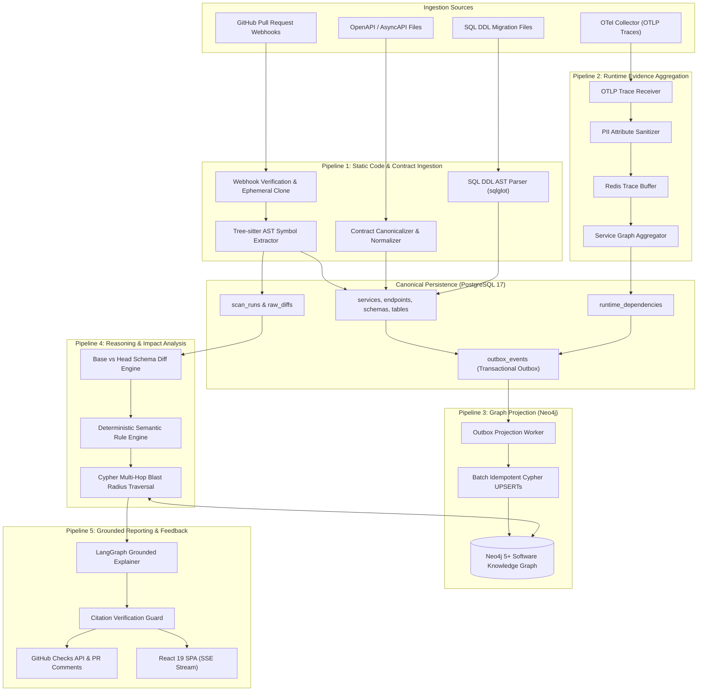
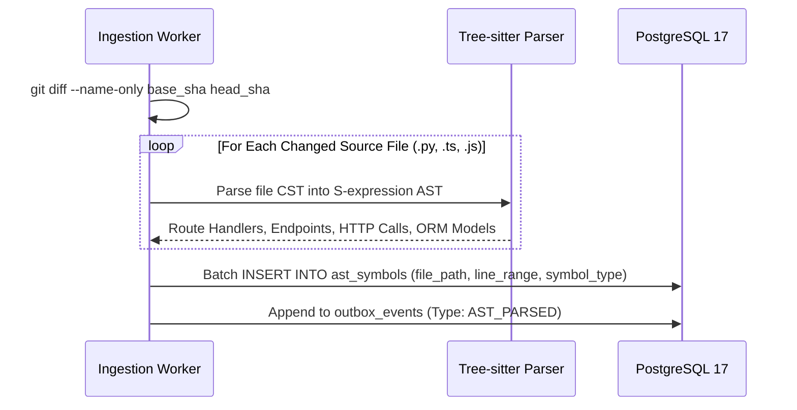
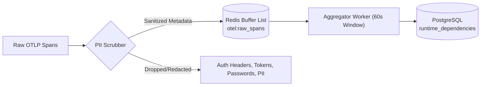
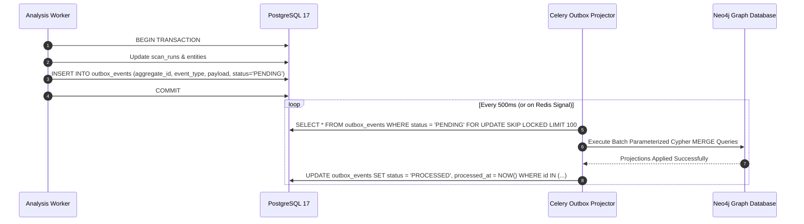
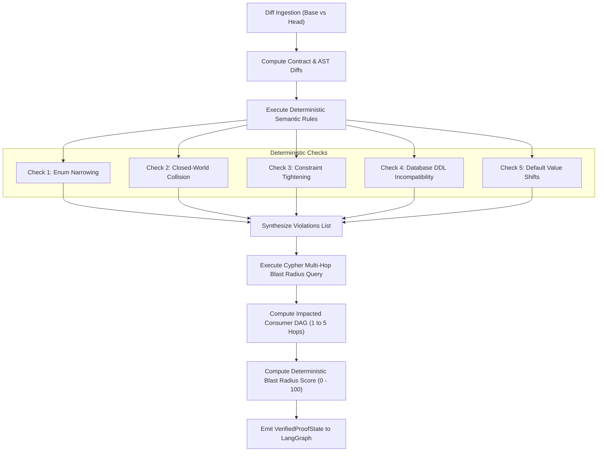
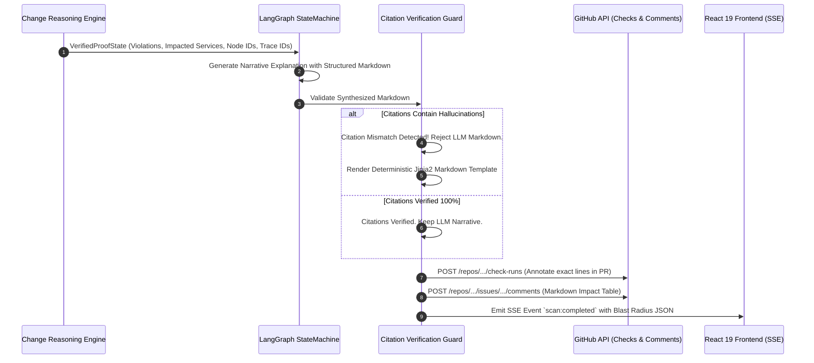

# DATA_FLOW.md
## ChangeScope: Data Pipelines, Ingestion Flows & Projection Architecture

**Document Version:** 1.0.0  
**Status:** Approved Data Architecture  
**Author:** Principal Software Architect & Data Platform Engineer  

---

### Executive Summary

ChangeScope orchestrates five distinct, high-throughput data pipelines to bridge static source code, API/DB contracts, runtime observability, and graph projections. This document specifies the exact flow of data across systems, serialization formats, state transitions, and reconciliation checkpoints.

---

## 1. End-to-End Data Pipeline Architecture



---

## 2. Pipeline 1: Static Code & Contract Ingestion Flow

### 2.1 Trigger & Ephemeral Lifecycle
1. GitHub delivers `pull_request.opened` or `pull_request.synchronize` payload with HMAC-SHA256 signature in header `X-Hub-Signature-256`.
2. The Gateway authenticates the webhook and enqueues a `RepoIngestTask` to Redis.
3. The Celery worker clones the repository to an isolated, in-memory directory: `/tmp/workspaces/{tenant_id}/{scan_id}` with `--depth=2` to fetch both `base_sha` and `head_sha`.
4. **Zero-Retention Guarantee:** Immediately upon completion of AST symbol and contract extraction, the entire tmpfs workspace is securely unlinked.

### 2.2 AST & Symbol Processing Flow


---

## 3. Pipeline 2: Runtime Evidence Ingestion Flow (OpenTelemetry)

### 3.1 Trace Ingestion & Sanitization
OpenTelemetry trace spans arrive via OTLP/HTTP or OTLP/gRPC at `/v1/traces`. To guarantee privacy and compliance, all spans pass through a high-throughput **PII Scrubbing Filter** prior to buffering:



### 3.2 Extracted Attributes
ChangeScope filters only for spans with network boundary semantics:
* `SPAN_KIND_SERVER`: Identifies provider endpoints.
  * Extracted: `service.name`, `http.route`, `http.request.method`, `http.response.status_code`, `rpc.method`.
* `SPAN_KIND_CLIENT`: Identifies consumer invocation calls.
  * Extracted: `service.name` (caller), `peer.service` (target), `url.path`, `http.status_code`.
* `SPAN_KIND_PRODUCER` / `SPAN_KIND_CONSUMER`: Identifies event stream messaging.
  * Extracted: `service.name`, `messaging.system` (Kafka, RabbitMQ), `messaging.destination.name`.

### 3.3 Aggregation Window & Upsert
Every 60 seconds, the Aggregator computes rolling 7-day metrics:
* $\text{Call Volume} = \sum \text{Spans in 7-day window}$
* $\text{p95 Latency} = \text{Percentile}_{95}(\text{duration\_ms})$
* Writes aggregated summary to `runtime_dependencies` and emits `TRACES_ENRICHED` outbox event.

---

## 4. Pipeline 3: Graph Outbox Reconciliation & Projection Flow

To satisfy the invariant that **PostgreSQL is canonical and Neo4j is a rebuildable projection**, all graph mutations pass through the transactional outbox:



### 4.1 Sample Outbox Event Payload
```json
{
  "event_id": "c1f7b8e0-4a82-4f3e-9081-123456789abc",
  "tenant_id": "80084afc-fdd9-4b0f-8aca-cd5a2615bf86",
  "event_type": "SCAN_PROJECTION_PENDING",
  "payload": {
    "scan_id": "scan-9901",
    "service": {
      "id": "srv-inventory",
      "name": "inventory-service",
      "tier": "TIER_1"
    },
    "endpoints": [
      {
        "id": "ep-inv-check",
        "method": "POST",
        "path_template": "/api/v1/inventory/check",
        "request_schema_id": "sch-inv-req-v2",
        "response_schema_id": "sch-inv-res-v2"
      }
    ],
    "dependencies": [
      {
        "caller_service_id": "srv-checkout",
        "target_endpoint_id": "ep-inv-check",
        "provenance": "OTEL_TRACE",
        "confidence": 0.95,
        "is_observed": true,
        "call_count_7d": 845000,
        "p95_latency_ms": 32.4
      }
    ]
  }
}
```

---

## 5. Pipeline 4: Semantic Change Evaluation & Blast Radius Flow



---

## 6. Pipeline 5: Grounded Reporting & Feedback Flow


