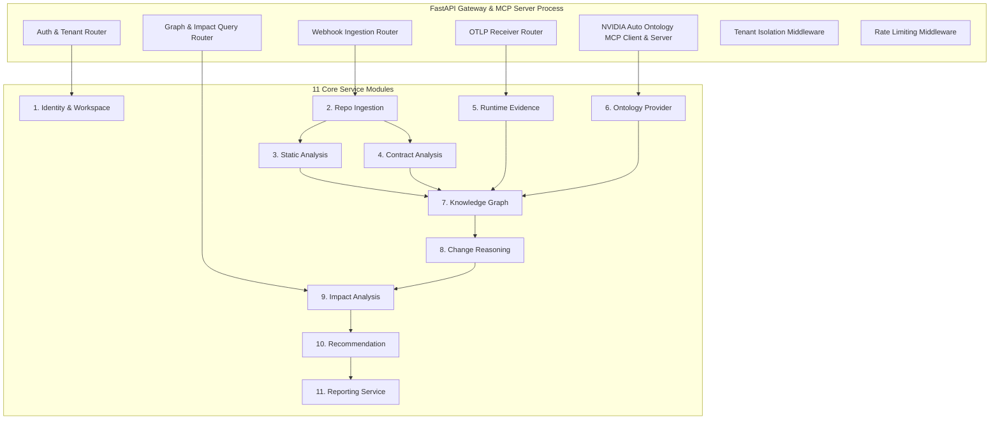
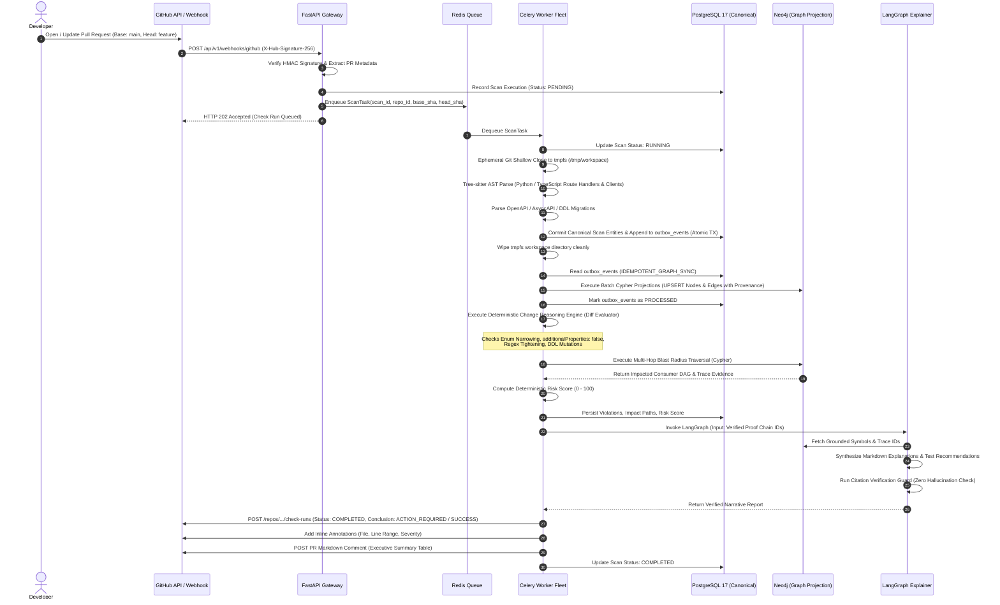
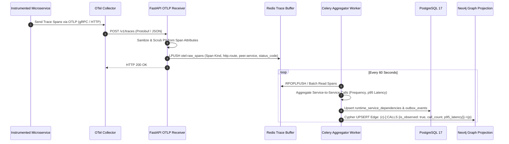
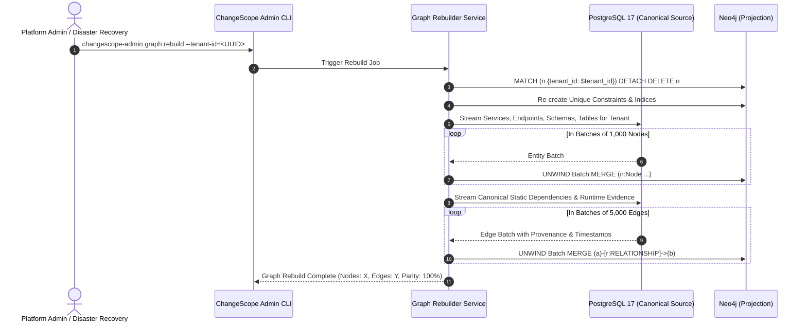

# HLD.md
## ChangeScope: High-Level Design (HLD)

**Document Version:** 1.0.0  
**Status:** Approved High-Level Architecture  
**Author:** Principal Software Architect & Staff Engineer  

---

### Executive Summary

This document presents the High-Level Design (HLD) of **ChangeScope**, illustrating the system context, container boundaries, component interactions, and end-to-end operational sequences. ChangeScope operates as a hybrid static-dynamic change intelligence platform where **PostgreSQL 17 serves as the canonical transaction store** and **Neo4j acts as an asynchronously synchronized, rebuildable graph projection**.

---

## 1. System Context Diagram (C4 Level 1)

The System Context diagram describes ChangeScope's boundaries and interactions with external actors, source control systems, and observability platforms.

```mermaid
flowchart TD
    User["Software Engineer / Tech Lead"]
    GH["GitHub / GitLab SCM\n(Webhooks & Pull Requests)"]
    OTelCollector["OpenTelemetry Collector\n(OTLP Traces)"]
    NVIDIA_MCP["NVIDIA Auto Ontology\n(MCP Semantic Grounding)"]

    subgraph ChangeScopeSystem ["ChangeScope Change Intelligence Platform"]
        CS["ChangeScope Core Platform\n(FastAPI Gateway, Celery Workers,\nPostgreSQL & Neo4j)"]
    end

    GH -->|1. Deliver PR Webhook Event| CS
    OTelCollector -->|2. Stream Runtime Trace Spans| CS
    User -->|3. View Dashboards & Blast Radius Graph| CS
    CS -->|4. Post GitHub Checks & PR Annotations| GH
    CS <-->|5. Semantic Layer Queries (MCP)| NVIDIA_MCP
    User -->|6. Review Pre-Merge Explanations| GH
```

---

## 2. Container Diagram (C4 Level 2)

The Container diagram details the high-level deployable units comprising the ChangeScope modular monolith:

```mermaid
flowchart TD
    subgraph ClientBoundary ["Client Layer"]
        SPA["Single Page App (React 19 + Vite)\nTailwind CSS, shadcn/ui, @xyflow/react"]
        SCM["GitHub / GitLab Webhook Dispatcher"]
        OTelAgent["OTel Ingestion Agent"]
    end

    subgraph ChangeScopePlatform ["ChangeScope Application Platform"]
        API["FastAPI Gateway & MCP Server\n(Python 3.12, Uvicorn, Port 8000)"]
        
        subgraph WorkerFleet ["Celery Worker Fleet (Python 3.12)"]
            W_Ingest["Worker: Ingestion & Static Parser\n(Tree-sitter, Git, OAS, DDL)"]
            W_Outbox["Worker: Graph Outbox Projector\n(Reconciliation & Neo4j Sync)"]
            W_Reason["Worker: Change Reasoning & Rules\n(Deterministic Rules & Blast Radius)"]
            W_Report["Worker: Reporting & LangGraph\n(Evidence Grounding & GitHub Checks)"]
        end

        RedisQueue[("Redis 7\n(Task Broker, Cache & Trace Buffer)")]
        PG[("PostgreSQL 17\n(Canonical Relational Database)")]
        NEO[("Neo4j 5+\n(Rebuildable Graph Projection)")]
        TmpFS["Ephemeral tmpfs Workspace\n(/tmp/changescope_workspaces)"]
    end

    SPA -->|REST API / SSE| API
    SCM -->|POST /api/v1/webhooks/github| API
    OTelAgent -->|POST /v1/traces (OTLP)| API

    API -->|Authenticate & Route| PG
    API -->|Enqueue Work Items| RedisQueue
    API -->|Direct Graph Reads for UI| NEO

    RedisQueue --> W_Ingest
    RedisQueue --> W_Outbox
    RedisQueue --> W_Reason
    RedisQueue --> W_Report

    W_Ingest -->|Shallow Git Clone / Parse| TmpFS
    W_Ingest -->|Write Commits, Diffs, Outbox| PG
    W_Outbox -->|Poll Outbox Events| PG
    W_Outbox -->|Apply Cypher Projections| NEO
    W_Reason -->|Read Diffs & Graph Topology| NEO
    W_Reason -->|Write Violations & Scores| PG
    W_Report -->|Fetch Evidence Chain| NEO
    W_Report -->|Post Annotations & Comments| SCM
```

---

## 3. Component Diagram (C4 Level 3)

The Component diagram breaks down the internal architecture of the FastAPI Gateway and the Celery Worker process, mapping the 11 Core Services into clear domain boundaries:



---

## 4. End-to-End Sequence Diagrams

### 4.1 Pull Request Change Analysis Sequence (Core Pipeline)
This sequence traces the complete execution lifecycle when a developer opens or updates a Pull Request on GitHub.



---

### 4.2 Runtime Evidence Ingestion Sequence
This sequence details how OpenTelemetry trace spans are ingested, buffered, aggregated, and projected onto graph relationships:



---

### 4.3 Knowledge Graph Disaster Recovery & Full Rebuild Sequence
Demonstrating that **Neo4j is an asynchronously derived, 100% rebuildable projection**:



---

## 5. Rebuildable Graph Projection & Outbox Architecture

### 5.1 Why Neo4j is a Projection (Not the Canonical Store)
1. **Transaction Integrity & Compliance:** Software governance requires ACID compliance, immutable audit logs, row-level tenant partitioning, and Point-in-Time Recovery (PITR). PostgreSQL provides enterprise-grade reliability, foreign key constraints, and mature backup tooling.
2. **Graph Optimization:** Neo4j excels at index-free adjacency and deep transitive traversals (`CALLS*1..5`). By treating Neo4j as an index projection, graph schema changes or corruption never endanger canonical data.
3. **Disaster Recovery:** If Neo4j becomes corrupt or out-of-sync, the entire graph can be rebuilt deterministically from PostgreSQL within minutes without data loss.

### 5.2 Transactional Outbox Pattern Details
Whenever a scan or trace aggregation modifies the canonical data in PostgreSQL:
1. **Single Transaction Boundary:**
   ```sql
   BEGIN TRANSACTION;
   -- 1. Insert or update scan results
   INSERT INTO scan_runs (...) VALUES (...);
   -- 2. Insert outbox projection event
   INSERT INTO outbox_events (id, tenant_id, event_type, payload, status)
   VALUES (gen_random_uuid(), 'tenant-123', 'SCAN_PROJECTION_PENDING', '{...}', 'PENDING');
   COMMIT;
   ```
2. **Asynchronous Projector:** A Celery worker polls pending outbox records with `SELECT ... FOR UPDATE SKIP LOCKED`, generates the corresponding Cypher statements, executes them within Neo4j transactions, and updates the outbox status to `PROCESSED`.
3. **Idempotent Cypher Mutations:** All projection Cypher queries utilize `MERGE` statements with deterministic composite keys (`tenant_id`, `id`) to ensure that replaying an outbox event produces zero duplicate nodes or relationships.

---

## 6. Alternatives Rejected & Architectural Trade-offs

| Architectural Decision | Alternative Considered | Why Rejected | Chosen Approach |
| :--- | :--- | :--- | :--- |
| **System Packaging** | Independent Microservices per Module (11 separate microservices) | **High Operational Overhead:** Increases network hops, distributed transaction complexity, serialization cost, and local developer setup friction. | **Modular Monolith:** Single deployable container fleet with strict Python package boundaries and shared relational connection pools. |
| **Primary Persistence** | Neo4j as Canonical Store | **Data Loss & ACID Risk:** Graph databases lack mature relational constraints, strict foreign keys, point-in-time backup tooling, and fine-grained row-level security. | **PostgreSQL 17 as Canonical Store; Neo4j as Rebuildable Projection.** |
| **AST Extraction** | Language Server Protocol (LSP) / Native Compilers | **Heavy & Fragile:** Requires full compiler toolchains, package installations (`npm install`, `pip install`), and memory-intensive LSP daemons in CI. | **Tree-sitter:** High-speed, fault-tolerant C/Wasm parsing in-memory without compiling or resolving dependencies. |
| **Risk Scoring** | LLM-Generated Risk Score (Prompting an LLM: "Rate this PR risk 1-100") | **Non-Deterministic & Hallucinatory:** Same PR receives different scores; cannot explain mathematical derivation; un-auditable. | **Deterministic Formula:** $R = \min(100, \text{Severity} \times (\text{Depth} + \log(\text{Volume})))$ with verified proof chains. |
| **Contract Ingestion** | Dynamic Traffic Recording Only | **Misses Inactive & Rare Paths:** Staging environments often lack traffic for edge-case endpoints; changes merge undetected. | **Hybrid Static-Dynamic:** Ingest static OpenAPI/AsyncAPI files first, enrich with live OTel spans. |
| **Agent Framework** | Autonomous ReAct Loop (AutoGPT style) | **Unpredictable Latency & Runaway Loops:** Agent may execute 50 iterative tool calls, blowing past the 60-second CI timeout. | **LangGraph StateGraph:** Deterministic acyclic/cyclical state machine with hard timeouts and strict grounding guards. |
