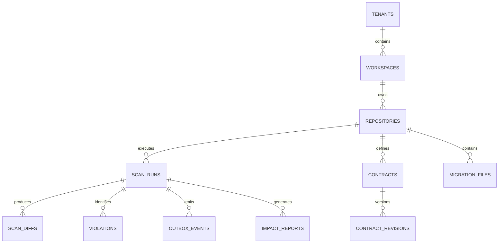
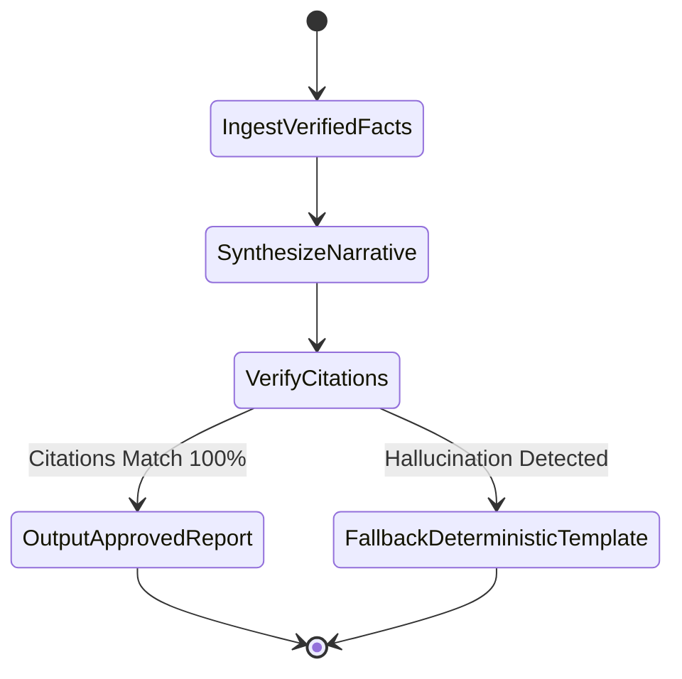

# LLD.md
## ChangeScope: Low-Level Design (LLD) & Data Engineering

**Document Version:** 1.0.0  
**Status:** Approved Low-Level Technical Specification  
**Author:** Principal Software Architect, Staff Engineer & Database Architect  

---

### Executive Summary

This document specifies the exact technical structures, schemas, algorithms, and code contracts for ChangeScope. It details the **PostgreSQL 17 canonical relational schema (SQLAlchemy 2.0)**, the **Neo4j graph ontology and Cypher schemas**, **Tree-sitter S-expression queries**, the **deterministic semantic change rule algorithms**, and the **LangGraph state machine with strict citation guards**.

---

## 1. PostgreSQL 17 Canonical Relational Schema

All application state is canonically modeled in PostgreSQL 17. The database uses UUIDv7 primary keys for time-ordered locality and supports multi-tenant isolation via mandatory `tenant_id` columns with compound indexes.



### 1.1 Core Tables & Column Definitions

```sql
-- 1. Tenant & Workspace Partitioning
CREATE TABLE tenants (
    id UUID PRIMARY KEY DEFAULT gen_random_uuid(),
    name VARCHAR(255) NOT NULL,
    slug VARCHAR(100) UNIQUE NOT NULL,
    created_at TIMESTAMPTZ NOT NULL DEFAULT NOW(),
    updated_at TIMESTAMPTZ NOT NULL DEFAULT NOW()
);

CREATE TABLE workspaces (
    id UUID PRIMARY KEY DEFAULT gen_random_uuid(),
    tenant_id UUID NOT NULL REFERENCES tenants(id) ON DELETE CASCADE,
    name VARCHAR(255) NOT NULL,
    slug VARCHAR(100) NOT NULL,
    created_at TIMESTAMPTZ NOT NULL DEFAULT NOW(),
    UNIQUE(tenant_id, slug)
);

-- 2. Repositories
CREATE TABLE repositories (
    id UUID PRIMARY KEY DEFAULT gen_random_uuid(),
    workspace_id UUID NOT NULL REFERENCES workspaces(id) ON DELETE CASCADE,
    tenant_id UUID NOT NULL REFERENCES tenants(id) ON DELETE CASCADE,
    name VARCHAR(255) NOT NULL,
    clone_url TEXT NOT NULL,
    default_branch VARCHAR(100) NOT NULL DEFAULT 'main',
    primary_language VARCHAR(50) NOT NULL, -- 'python', 'typescript', etc.
    tier VARCHAR(20) NOT NULL DEFAULT 'TIER_2', -- 'TIER_1' (Critical), 'TIER_2', 'TIER_3'
    created_at TIMESTAMPTZ NOT NULL DEFAULT NOW(),
    UNIQUE(workspace_id, name)
);

-- 3. Scan Executions (PR Runs)
CREATE TABLE scan_runs (
    id UUID PRIMARY KEY DEFAULT gen_random_uuid(),
    tenant_id UUID NOT NULL REFERENCES tenants(id) ON DELETE CASCADE,
    repository_id UUID NOT NULL REFERENCES repositories(id) ON DELETE CASCADE,
    pr_number INTEGER,
    base_sha CHAR(40) NOT NULL,
    head_sha CHAR(40) NOT NULL,
    status VARCHAR(50) NOT NULL, -- 'PENDING', 'RUNNING', 'COMPLETED', 'FAILED'
    risk_score INTEGER,          -- Deterministic 0 - 100
    risk_level VARCHAR(20),      -- 'LOW', 'MEDIUM', 'HIGH', 'CRITICAL'
    started_at TIMESTAMPTZ NOT NULL DEFAULT NOW(),
    completed_at TIMESTAMPTZ,
    error_message TEXT
);
CREATE INDEX idx_scan_runs_repo_shas ON scan_runs(repository_id, base_sha, head_sha);

-- 4. Transactional Outbox for Graph Projection
CREATE TABLE outbox_events (
    id UUID PRIMARY KEY DEFAULT gen_random_uuid(),
    tenant_id UUID NOT NULL REFERENCES tenants(id) ON DELETE CASCADE,
    aggregate_type VARCHAR(100) NOT NULL, -- 'SCAN', 'TRACE_BATCH', 'CONTRACT'
    aggregate_id UUID NOT NULL,
    event_type VARCHAR(100) NOT NULL,     -- 'SCAN_PROJECTION_PENDING', 'TRACES_ENRICHED'
    payload JSONB NOT NULL,
    status VARCHAR(50) NOT NULL DEFAULT 'PENDING', -- 'PENDING', 'PROCESSED', 'FAILED'
    retry_count INTEGER NOT NULL DEFAULT 0,
    created_at TIMESTAMPTZ NOT NULL DEFAULT NOW(),
    processed_at TIMESTAMPTZ
);
CREATE INDEX idx_outbox_pending ON outbox_events(status, created_at) WHERE status = 'PENDING';

-- 5. API & Event Contracts (OpenAPI, AsyncAPI, JSON Schema)
CREATE TABLE contracts (
    id UUID PRIMARY KEY DEFAULT gen_random_uuid(),
    tenant_id UUID NOT NULL REFERENCES tenants(id) ON DELETE CASCADE,
    repository_id UUID NOT NULL REFERENCES repositories(id) ON DELETE CASCADE,
    contract_type VARCHAR(50) NOT NULL, -- 'OPENAPI_3', 'ASYNCAPI_2', 'ASYNCAPI_3', 'JSON_SCHEMA'
    file_path TEXT NOT NULL,
    created_at TIMESTAMPTZ NOT NULL DEFAULT NOW(),
    UNIQUE(repository_id, file_path)
);

CREATE TABLE contract_revisions (
    id UUID PRIMARY KEY DEFAULT gen_random_uuid(),
    contract_id UUID NOT NULL REFERENCES contracts(id) ON DELETE CASCADE,
    commit_sha CHAR(40) NOT NULL,
    content_hash CHAR(64) NOT NULL, -- SHA-256 of raw specification
    raw_content TEXT NOT NULL,
    canonical_spec JSONB NOT NULL,  -- Fully dereferenced and normalized AST
    created_at TIMESTAMPTZ NOT NULL DEFAULT NOW(),
    UNIQUE(contract_id, commit_sha)
);

-- 6. Detected Semantic Violations
CREATE TABLE violations (
    id UUID PRIMARY KEY DEFAULT gen_random_uuid(),
    scan_id UUID NOT NULL REFERENCES scan_runs(id) ON DELETE CASCADE,
    tenant_id UUID NOT NULL REFERENCES tenants(id) ON DELETE CASCADE,
    rule_code VARCHAR(100) NOT NULL, -- 'ENUM_NARROWED', 'CLOSED_WORLD_COLLISION', 'DDL_TYPE_MUTATED'
    severity VARCHAR(20) NOT NULL,   -- 'BLOCKING', 'WARNING', 'INFO'
    file_path TEXT NOT NULL,
    start_line INTEGER NOT NULL,
    end_line INTEGER NOT NULL,
    json_pointer TEXT,               -- e.g. /paths/~1orders/post/requestBody
    impacted_service_id UUID,
    evidence_payload JSONB NOT NULL, -- Structured proof details
    created_at TIMESTAMPTZ NOT NULL DEFAULT NOW()
);

-- 7. Runtime Dependency Aggregations (from OpenTelemetry)
CREATE TABLE runtime_dependencies (
    id UUID PRIMARY KEY DEFAULT gen_random_uuid(),
    tenant_id UUID NOT NULL REFERENCES tenants(id) ON DELETE CASCADE,
    caller_service_name VARCHAR(255) NOT NULL,
    callee_service_name VARCHAR(255) NOT NULL,
    http_route VARCHAR(255) NOT NULL,
    http_method VARCHAR(10) NOT NULL,
    call_count_7d BIGINT NOT NULL DEFAULT 0,
    p95_latency_ms DOUBLE PRECISION NOT NULL DEFAULT 0.0,
    last_observed_at TIMESTAMPTZ NOT NULL,
    UNIQUE(tenant_id, caller_service_name, callee_service_name, http_route, http_method)
);
```

---

## 2. Neo4j Graph Ontology & Cypher Schema

Neo4j is an **asynchronously synchronized, rebuildable graph projection** driven by the `outbox_events` table.

```mermaid
graph TD
    Service["(:Service)"]
    Endpoint["(:Endpoint)"]
    Schema["(:Schema)"]
    Prop["(:SchemaProperty)"]
    Channel["(:MessageChannel)"]
    Table["(:DatabaseTable)"]
    Column["(:DatabaseColumn)"]
    Symbol["(:CodeSymbol)"]

    Service -->|EXPOSES| Endpoint
    Endpoint -->|ACCEPTS_SCHEMA| Schema
    Endpoint -->|RETURNS_SCHEMA| Schema
    Schema -->|CONTAINS_PROPERTY| Prop
    Service -->|CALLS {provenance, confidence}| Endpoint
    Service -->|PUBLISHES_TO| Channel
    Service -->|SUBSCRIBES_TO| Channel
    Symbol -->|IMPLEMENTS| Endpoint
    Symbol -->|INVOKES_CLIENT| Endpoint
    Symbol -->|QUERIES| Table
    Table -->|HAS_COLUMN| Column
    Service -->|ASSUMES_CONTRACT {validation_mode}| Schema
```

### 2.1 Neo4j Constraints & Indices

```cypher
// 1. Mandatory Uniqueness Constraints
CREATE CONSTRAINT c_service_id IF NOT EXISTS FOR (s:Service) REQUIRE (s.tenant_id, s.id) IS UNIQUE;
CREATE CONSTRAINT c_endpoint_id IF NOT EXISTS FOR (e:Endpoint) REQUIRE (e.tenant_id, e.id) IS UNIQUE;
CREATE CONSTRAINT c_schema_id IF NOT EXISTS FOR (sc:Schema) REQUIRE (sc.tenant_id, sc.id) IS UNIQUE;
CREATE CONSTRAINT c_table_id IF NOT EXISTS FOR (t:DatabaseTable) REQUIRE (t.tenant_id, t.id) IS UNIQUE;
CREATE CONSTRAINT c_channel_id IF NOT EXISTS FOR (ch:MessageChannel) REQUIRE (ch.tenant_id, ch.id) IS UNIQUE;

// 2. Performance Composite Indexes for Fast Path Traversals
CREATE INDEX idx_endpoint_route IF NOT EXISTS FOR (e:Endpoint) ON (e.tenant_id, e.method, e.path_template);
CREATE INDEX idx_service_name IF NOT EXISTS FOR (s:Service) ON (s.tenant_id, s.name);
CREATE INDEX idx_calls_observed IF NOT EXISTS FOR ()-[r:CALLS]-() ON (r.tenant_id, r.is_observed);
```

### 2.2 Relationship Schema & Required Properties

Every edge in the graph must satisfy the provenance invariant:

| Relationship | Start Node $\rightarrow$ End Node | Required Attributes |
| :--- | :--- | :--- |
| `EXPOSES` | `(:Service) -> (:Endpoint)` | `tenant_id`, `created_at` |
| `CALLS` | `(:Service) -> (:Endpoint)` | `tenant_id`, `provenance` (`STATIC_AST` \| `OTEL_TRACE`), `confidence` (0.0-1.0), `is_observed` (bool), `call_count`, `p95_latency_ms`, `last_observed_at`, `evidence_ref` |
| `ACCEPTS_SCHEMA` | `(:Endpoint) -> (:Schema)` | `tenant_id`, `content_type` (`application/json`) |
| `RETURNS_SCHEMA` | `(:Endpoint) -> (:Schema)` | `tenant_id`, `status_code` (`200`, `201`), `content_type` |
| `ASSUMES_CONTRACT` | `(:Service) -> (:Schema)` | `tenant_id`, `validation_mode` (`OPEN_WORLD` \| `CLOSED_WORLD`), `provenance` |
| `MUTATES` | `(:MigrationScript) -> (:DatabaseTable)` | `tenant_id`, `operation` (`ALTER_COLUMN`, `DROP_COLUMN`, `ADD_CONSTRAINT`) |
| `QUERIES` | `(:CodeSymbol) -> (:DatabaseTable)` | `tenant_id`, `query_type` (`SELECT`, `INSERT`, `UPDATE`, `DELETE`) |

---

## 3. Tree-sitter AST S-Expression Queries

Tree-sitter performs high-speed AST parsing in memory. The following S-expressions extract routes and outbound HTTP calls without compilation:

### 3.1 Python (FastAPI & Requests)

```scheme
; 1. FastAPI Route Decorator Extraction
(decorated_definition
  (decorator
    (call
      function: (attribute
        object: (identifier) @router_var
        attribute: (identifier) @http_method
        (#match? @http_method "^(get|post|put|delete|patch|options)$")
      )
      arguments: (argument_list
        (string) @path_template
      )
    )
  )
  definition: (function_definition
    name: (identifier) @function_name
  ) @function_node
)

; 2. Outbound HTTP Client Call Extraction (httpx / requests)
(call
  function: (attribute
    object: (identifier) @client_obj (#match? @client_obj "^(requests|httpx|client)$")
    attribute: (identifier) @method_name (#match? @method_name "^(get|post|put|delete|patch)$")
  )
  arguments: (argument_list
    .
    [
      (string) @raw_url
      (identifier) @url_var
      (binary_operator) @concat_url
    ]
  )
) @call_site
```

### 3.2 TypeScript / JavaScript (Express & NestJS)

```scheme
; 1. Express Route Registration
(call_expression
  function: (member_expression
    object: (identifier) @app_var
    property: (property_identifier) @http_method
    (#match? @http_method "^(get|post|put|delete|patch)$")
  )
  arguments: (arguments
    (string) @path_template
    [
      (arrow_function)
      (function_expression)
      (identifier)
    ] @handler_ref
  )
)

; 2. NestJS Controller & Method Decorators
(class_declaration
  (decorator
    (call_expression
      function: (identifier) @controller_dec (#eq? @controller_dec "Controller")
      arguments: (arguments (string) @base_path)
    )
  )
  body: (class_body
    (method_definition
      (decorator
        (call_expression
          function: (identifier) @method_dec (#match? @method_dec "^(Get|Post|Put|Delete|Patch)$")
          arguments: (arguments (string) @sub_path)?
        )
      )
      name: (property_identifier) @method_name
    )
  )
)
```

---

## 4. Deterministic Semantic Change Rule Algorithms

The `ChangeReasoningEngine` executes pure, deterministic algorithms to evaluate contract diffs between the PR branch (`head`) and base branch (`base`).

### 4.1 Rule 1: Enum Narrowing Algorithm
**Hazard:** Producer removes an allowed string from an enum, causing downstream consumer deserialization to throw unexpected value exceptions.

```python
def check_enum_narrowing(base_schema: dict, head_schema: dict, json_pointer: str) -> list[Violation]:
    base_enums = set(base_schema.get("enum", []))
    head_enums = set(head_schema.get("enum", []))
    
    if not base_enums:
        return []
        
    removed_values = base_enums - head_enums
    if removed_values:
        return [
            Violation(
                rule_code="RULE_ENUM_NARROWED",
                severity="BLOCKING",
                json_pointer=json_pointer,
                message=f"Enum narrowed. Removed values: {sorted(list(removed_values))}. Existing consumers will fail deserialization.",
                evidence={
                    "removed_values": sorted(list(removed_values)),
                    "base_enums": sorted(list(base_enums)),
                    "head_enums": sorted(list(head_enums))
                }
            )
        ]
    return []
```

### 4.2 Rule 2: Closed-World Property Collision (`additionalProperties: false`)
**Hazard:** Producer adds an optional property (`warehouse_id`). Mechanically backward-compatible per OpenAPI, but immediately rejected with HTTP 422 by downstream consumers enforcing closed-world validation.

```python
def check_closed_world_collision(
    producer_added_props: set[str], 
    consumer_schemas: list[ConsumerSchemaNode]
) -> list[Violation]:
    violations = []
    for consumer in consumer_schemas:
        # Check if consumer validation explicitly forbids extra fields
        if consumer.validation_mode == "CLOSED_WORLD" or consumer.schema_json.get("additionalProperties") is False:
            conflicting_props = producer_added_props - set(consumer.known_properties)
            if conflicting_props:
                violations.append(
                    Violation(
                        rule_code="RULE_CLOSED_WORLD_COLLISION",
                        severity="BLOCKING",
                        impacted_service_id=consumer.service_id,
                        message=f"Producer added properties {conflicting_props}, but consumer '{consumer.service_name}' enforces 'additionalProperties: false'.",
                        evidence={
                            "conflicting_properties": sorted(list(conflicting_props)),
                            "consumer_service": consumer.service_name,
                            "consumer_schema_ref": consumer.schema_id
                        }
                    )
                )
    return violations
```

### 4.3 Rule 3: Database DDL Mutation Incompatibility
**Hazard:** A migration reduces column length or sets `NOT NULL` without a default while a downstream service queries that column.

```python
def check_ddl_mutation_incompatibility(
    ddl_events: list[DDLEvent], 
    active_orm_references: list[ORMColumnReference]
) -> list[Violation]:
    violations = []
    for event in ddl_events:
        if event.type == "ALTER_COLUMN_TYPE":
            # e.g. VARCHAR(64) -> VARCHAR(32)
            if event.new_length and event.old_length and event.new_length < event.old_length:
                for ref in active_orm_references:
                    if ref.table_name == event.table_name and ref.column_name == event.column_name:
                        violations.append(
                            Violation(
                                rule_code="RULE_DDL_COLUMN_SHRUNK",
                                severity="BLOCKING",
                                impacted_service_id=ref.service_id,
                                message=f"Column '{event.column_name}' in table '{event.table_name}' shrunk from {event.old_length} to {event.new_length}. Service '{ref.service_name}' queries this column.",
                                evidence={
                                    "table": event.table_name,
                                    "column": event.column_name,
                                    "old_length": event.old_length,
                                    "new_length": event.new_length,
                                    "referencing_service": ref.service_name
                                }
                            )
                        )
    return violations
```

---

## 5. Multi-Hop Blast Radius Traversal & Scoring Formula

### 5.1 Cypher Multi-Hop Traversal Query
The `ImpactAnalysisService` executes the following optimized Cypher query to identify all direct and transitive downstream dependents up to 5 network hops away:

```cypher
MATCH path = (root:Endpoint {id: $endpoint_id, tenant_id: $tenant_id})
  <-[:CALLS*1..5]-(consumer:Service {tenant_id: $tenant_id})
WHERE ALL(r IN relationships(path) WHERE r.confidence >= 0.70)
WITH consumer, 
     length(path) AS hop_distance,
     reduce(weight = 1.0, r IN relationships(path) | weight * r.confidence) AS path_confidence,
     [r IN relationships(path) | r.is_observed] AS observed_flags,
     [n IN nodes(path) | n.name] AS traversal_names
RETURN 
  consumer.id AS service_id,
  consumer.name AS service_name,
  consumer.tier AS service_tier,
  min(hop_distance) AS min_depth,
  max(path_confidence) AS max_confidence,
  any(flag IN observed_flags WHERE flag = true) AS has_runtime_evidence,
  collect(traversal_names) AS evidence_paths
ORDER BY min_depth ASC, service_tier ASC;
```

### 5.2 Deterministic Blast Radius Score Formula
The Blast Radius Risk Score $R \in [0, 100]$ is computed algorithmically:

$$R = \min\left(100, \; \text{BaseSeverity}(S) + \sum_{c \in \text{ImpactedConsumers}} \left( \text{TierWeight}(c) \times \frac{1}{\text{Depth}(c)} \times \text{Confidence}(c) \times \log_{10}(\text{RPM}(c) + 10) \right) \right)$$

Where:
* **$\text{BaseSeverity}(S)$:** `BLOCKING` violation = 50, `WARNING` = 25, `INFO` = 0.
* **$\text{TierWeight}(c)$:** `TIER_1` (Mission Critical) = 20, `TIER_2` = 10, `TIER_3` = 5.
* **$\text{Depth}(c)$:** Shortest hop distance from changed entity (Direct caller = 1, Transitive = 2..5).
* **$\text{Confidence}(c)$:** Edge confidence factor (0.0 to 1.0).
* **$\text{RPM}(c)$:** Observed requests per minute from OpenTelemetry runtime traces.

---

## 6. LangGraph Grounded Explainer State Machine

ChangeScope enforces a **zero-hallucination constraint**: the LLM does not determine risk; it only formats and synthesizes pre-computed graph evidence into human-readable explanations.



### 6.1 StateGraph Implementation Contract

```python
from typing import TypedDict, List
from langgraph.graph import StateGraph, END

class VerifiedProofState(TypedDict):
    scan_id: str
    tenant_id: str
    risk_score: int
    risk_level: str
    violations: List[dict]           # Pre-verified by Rule Engine
    impacted_services: List[dict]    # Pre-verified by Cypher query
    verified_symbols: List[str]      # Valid file paths & symbol names
    verified_span_ids: List[str]     # Valid OTel trace IDs
    synthesized_markdown: str        # Output of LLM
    citation_audit_passed: bool      # Result of validation guard

def synthesize_narrative_node(state: VerifiedProofState) -> dict:
    """Prompt the LLM with strict context injection."""
    prompt = f"""
    You are ChangeScope Architectural Explainer.
    Generate a markdown PR explanation based SOLELY on these verified facts:
    Risk Score: {state['risk_score']} ({state['risk_level']})
    Violations: {state['violations']}
    Impacted Services: {state['impacted_services']}
    
    RULES:
    1. You MUST only reference file paths and symbols present in: {state['verified_symbols']}.
    2. You MUST only cite trace IDs present in: {state['verified_span_ids']}.
    3. Do not invent any facts, downstream consumers, or recommendations not in context.
    """
    # Execute LLM call via abstracted provider
    response_markdown = llm_provider.generate(prompt)
    return {"synthesized_markdown": response_markdown}

def verify_citations_guard_node(state: VerifiedProofState) -> dict:
    """Verify that every cited file, symbol, and trace ID exists in input state."""
    text = state["synthesized_markdown"]
    
    # Check for hallucinated span IDs or unauthorized paths
    extracted_paths = extract_markdown_file_links(text)
    invalid_paths = [p for p in extracted_paths if p not in state["verified_symbols"]]
    
    if invalid_paths:
        # Reject hallucinated output; fall back to deterministic template
        return {
            "citation_audit_passed": False,
            "synthesized_markdown": generate_deterministic_fallback_report(state)
        }
    return {"citation_audit_passed": True}

# Build LangGraph workflow
workflow = StateGraph(VerifiedProofState)
workflow.add_node("synthesize", synthesize_narrative_node)
workflow.add_node("verify", verify_citations_guard_node)
workflow.set_entry_point("synthesize")
workflow.add_edge("synthesize", "verify")
workflow.add_edge("verify", END)
langgraph_explainer = workflow.compile()
```
