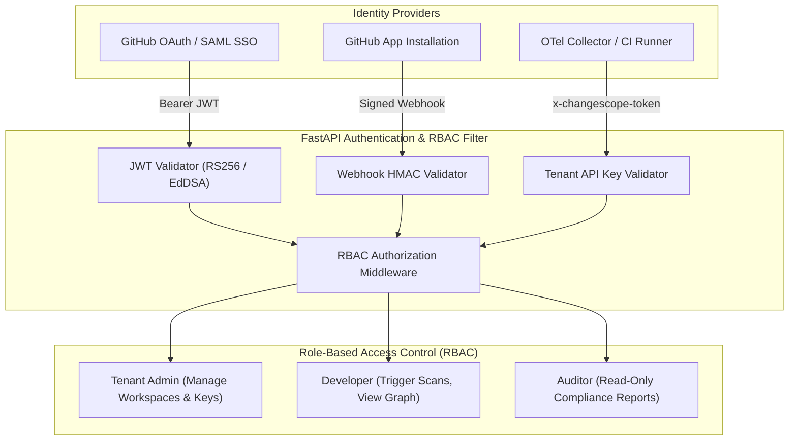
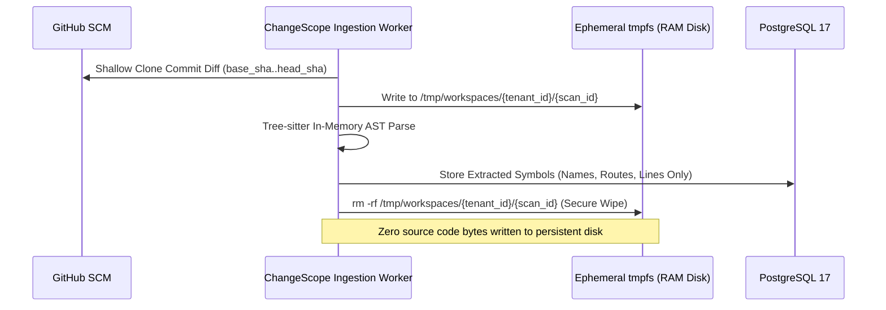

# SECURITY_ARCHITECTURE.md
## ChangeScope: Security Architecture, Tenant Isolation & Privacy Guardrails

**Document Version:** 1.0.0  
**Status:** Approved Security Architecture  
**Author:** Principal Security Architect & Staff Engineer  

---

### Executive Summary

ChangeScope analyzes mission-critical enterprise source code repositories, API contracts, and runtime telemetry. The security architecture enforces **strict multi-tenant isolation**, a **zero-source-code-retention policy**, **cryptographic webhook validation**, **PII sanitization for telemetry**, and a **provable zero-external-API-key offline testability posture**.

---

## 1. Threat Modeling & Security Posture

ChangeScope applies the **STRIDE** methodology across all ingestion, processing, and storage boundaries:

| Threat Category | Potential Attack Vector | ChangeScope Architectural Mitigation |
| :--- | :--- | :--- |
| **Spoofing** | Forged GitHub webhook events simulating pull requests. | Mandatory cryptographic `HMAC-SHA256` signature verification (`X-Hub-Signature-256`) using rotating webhook secrets. |
| **Tampering** | Man-in-the-middle manipulation of OTLP runtime traces. | Mandatory mTLS / TLS 1.3 encryption on OTLP receiver endpoints; token-based tenant authentication (`x-changescope-token`). |
| **Repudiation** | Malicious change merged with denied responsibility. | Immutable, append-only `scan_runs` and `audit_logs` in PostgreSQL 17 with cryptographic commit hashes. |
| **Information Disclosure** | Cross-tenant data leakage or source code exposure. | Multi-tenant Row-Level Security (RLS) in PostgreSQL; mandatory `tenant_id` constraints on Neo4j; **zero-retention ephemeral tmpfs cloning**. |
| **Denial of Service** | Webhook flooding or path traversal recursion bomb. | Asynchronous Celery buffering via Redis; hard depth limits ($N \le 5$) on Cypher traversals; 60s hard timeout per scan. |
| **Elevation of Privilege** | Read-only auditor attempting scan trigger or token retrieval. | Strict RBAC enforced at FastAPI gateway via JWT claims and scoped GitHub App installation tokens. |

---

## 2. Authentication & Authorization Architecture



### 2.1 GitHub App Cryptographic Authentication
1. **GitHub App Private Key:** ChangeScope stores the GitHub App RSA Private Key in AWS Secrets Manager or HashiCorp Vault.
2. **Short-Lived Installation Tokens:** To interact with GitHub APIs, ChangeScope signs a short-lived (10-minute) JWT using `RS256` and exchanges it via `POST /app/installations/{installation_id}/access_tokens` for a fine-grained, repository-scoped installation token.
3. **No Long-Lived Personal Access Tokens (PATs):** ChangeScope prohibits using developer PATs for repository ingestion.

### 2.2 Webhook Signature Validation Contract
Every incoming webhook is verified prior to payload JSON deserialization to protect against denial-of-service via malformed payloads:

```python
import hmac
import hashlib
from fastapi import Request, HTTPException, status

async def verify_github_webhook_signature(request: Request, webhook_secret: str) -> bytes:
    signature_header = request.headers.get("X-Hub-Signature-256")
    if not signature_header or not signature_header.startswith("sha256="):
        raise HTTPException(status_code=status.HTTP_401_UNAUTHORIZED, detail="Missing or invalid signature header")
    
    body = await request.body()
    expected_signature = "sha256=" + hmac.new(
        key=webhook_secret.encode("utf-8"),
        msg=body,
        digestmod=hashlib.sha256
    ).hexdigest()
    
    if not hmac.compare_digest(signature_header, expected_signature):
        raise HTTPException(status_code=status.HTTP_401_UNAUTHORIZED, detail="HMAC signature verification failed")
    
    return body
```

---

## 3. Strict Multi-Tenant Data Isolation

ChangeScope is a multi-tenant platform. Tenant isolation is enforced across both storage layers:

### 3.1 PostgreSQL 17 Tenant Isolation (Row-Level Security)
1. **Mandatory Foreign Keys:** Every application table contains a non-nullable `tenant_id UUID REFERENCES tenants(id) ON DELETE CASCADE`.
2. **Row-Level Security (RLS) Policy:**
   ```sql
   ALTER TABLE scan_runs ENABLE ROW LEVEL SECURITY;
   
   CREATE POLICY tenant_isolation_policy ON scan_runs
       AS RESTRICTIVE
       USING (tenant_id = NULLIF(current_setting('app.current_tenant_id', true), '')::uuid);
   ```
3. **Session Setting Middleware:** FastAPI middleware extracts `tenant_id` from the verified JWT and sets it on the database connection before query execution:
   ```python
   async with db_session.begin():
       await db_session.execute(text("SET LOCAL app.current_tenant_id = :tid"), {"tid": str(tenant_id)})
       # Execute tenant-scoped query
   ```

### 3.2 Neo4j Graph Tenant Partitioning
Neo4j does not natively partition a single database by row without Fabric or separate databases. ChangeScope achieves strict graph isolation within a shared database through **Ontological Label Partitioning & Cypher Scoping**:
1. **Mandatory Tenant Property:** Every node and relationship is stamped with `tenant_id: $tenant_id`.
2. **Cypher Query Scoping Invariant:** Every Cypher query executed by the `KnowledgeGraphService` must anchor on `tenant_id`:
   ```cypher
   // Invariant: Traversal MUST NOT cross tenant boundaries
   MATCH (s:Service {tenant_id: $tenant_id, id: $service_id})
     -[:CALLS*1..5 {tenant_id: $tenant_id}]->(e:Endpoint {tenant_id: $tenant_id})
   RETURN e;
   ```
3. **Compound Constraints:** Uniqueness constraints are strictly compound: `REQUIRE (s.tenant_id, s.id) IS UNIQUE`.

---

## 4. Zero-Source-Code-Retention Policy

Enterprise customers mandate that their intellectual property (raw source code) is never stored permanently on third-party servers.



### 4.1 Ephemeral Lifecycle Guarantees
* **RAM Disk Mount:** Worker workspaces are mounted on Linux `tmpfs` (RAM-backed filesystem).
* **Immediate Disposal:** The directory is deleted inside a `finally:` block immediately after Tree-sitter AST extraction finishes.
* **What is Persisted:** Only metadata is stored in PostgreSQL: symbol identifiers (e.g., function name `process_payment`), file paths (`src/api/payment.py`), and line ranges (`L45-L89`). Proprietary business logic code is never written to PostgreSQL or Neo4j.

---

## 5. OpenTelemetry Telemetry Privacy & PII Scrubbing

Runtime traces often contain sensitive customer data in HTTP query parameters, headers, or SQL statements. ChangeScope's OTLP ingestion pipeline scrubs attributes in-memory before buffering:

### 5.1 Scrubbing Rules
1. **Header Stripping:** Drop all headers matching: `authorization`, `cookie`, `set-cookie`, `x-api-key`, `proxy-authorization`.
2. **Regex PII Redaction:** Redact values matching:
   * Credit Card Numbers: `\b(?:\d{4}[ -]?){3}\d{4}\b` $\rightarrow$ `[REDACTED_PAN]`
   * Social Security Numbers: `\b\d{3}-\d{2}-\d{4}\b` $\rightarrow$ `[REDACTED_SSN]`
   * Email Addresses: `[a-zA-Z0-9_.+-]+@[a-zA-Z0-9-]+\.[a-zA-Z0-9-.]+` $\rightarrow$ `[REDACTED_EMAIL]`
3. **SQL Query Sanitization:** Strip raw literal values from SQL queries (`db.statement`), converting `SELECT * FROM users WHERE id = 1234` to `SELECT * FROM users WHERE id = ?`.

---

## 6. Offline Testability & Zero-External-Key Security

To comply with enterprise CI/CD security audits and permit deterministic offline local testing:
1. **No External Network Dependencies in Tests:** The entire test suite executes in air-gapped environments without external internet access.
2. **Testcontainers Architecture:** Integration tests spin up ephemeral Docker containers for PostgreSQL 17, Neo4j 5.20, and Redis 7.
3. **Mock Intelligence Engine:** External LLM calls (NVIDIA NIM, OpenAI) are intercepted by a deterministic offline mock adapter (`OfflineIntelligenceProvider`). It returns deterministic markdown summaries matching verified fixture IDs without contacting any remote AI endpoints.
