# ChangeScope Contract Intelligence Engine Architecture

## 1. Executive Summary & Purpose

The **ChangeScope Contract Intelligence Engine** evaluates distributed system interfaces—including OpenAPI 3.x, AsyncAPI 2.x/3.x, and JSON Schema specifications—across before-and-after versions, Git commit changes, SQL database migrations, and extracted codebase AST artifacts.

Unlike conventional syntactic diff tools that only verify JSON Schema schema validation rules, ChangeScope evaluates **structural breaking changes**, **semantic interpretations** (e.g. monetary denominations, duration units, timezone interpretations, identifier scope collisions, and status lifecycle drift), **event streaming evolution**, and **database migration impact**.

---

## 2. System Architecture

```mermaid
flowchart TD
    subgraph Inputs["1. Supported Multi-Modal Inputs"]
        OA["OpenAPI 3.x\n(REST APIs, Headers, Query/Path params)"]
        AA["AsyncAPI 2.x / 3.x\n(Kafka, RabbitMQ, Event Ordering)"]
        JS["JSON Schema\n(Arbitrary Schema Evolution)"]
        DDL["SQL DDL & Migrations\n(PostgreSQL / Alembic)"]
        CM["Code Mappings & AST\n(FastAPI, Express, ORM Models, HTTP Clients)"]
        CP["Consumer Profiles\n(Open vs Closed World)"]
    end

    subgraph CoreEngine["2. Contract Intelligence Engine (Master Coordinator)"]
        CIE["ContractIntelligenceEngine\n(packages/contracts/engine.py)"]
    end

    subgraph Differs["3. Specialized Analysis Differs"]
        SD["SchemaDiffer\n(Structural additions, removals, types, constraints, nullability, enums)"]
        OD["OpenAPIDiffer\n(Endpoints, HTTP methods, status codes, parameters)"]
        AD["AsyncAPIDiffer\n(Channels, operations, ordering, delivery, versioning)"]
        DD["DDLDiffer\n(Columns dropped/renamed, type truncation, nullability, constraints)"]
        SEM["SemanticDiffer\n(Currency units, time units, UTC/local, Customer vs Account, status drift)"]
        CSI["CandidateSemanticInterpreter\n(Heuristic & NLP Candidate Reasoning)"]
    end

    subgraph Output["4. Structured Findings"]
        CF["ContractFinding\n- finding_id\n- change_category\n- change_type\n- severity (BLOCKING / WARNING / INFO)\n- confidence (0.0 - 1.0)\n- before_state / after_state\n- affected_entities\n- supporting_evidence\n- uncertainty_explanation\n- recommended_verification"]
    end

    Inputs --> CIE
    CIE --> Differs
    Differs --> Output
```



---

## 3. Analysis Categories & Supported Invariant Rules

### 3.1. Category A: Structural Changes (`STRUCTURAL`)

| Change Type | Trigger Condition | Severity | Confidence | Downstream Impact |
| :--- | :--- | :--- | :--- | :--- |
| `FIELD_REMOVED` | Property deleted from response schema | `BLOCKING` | 1.0 | Consumers expecting the field encounter missing key errors. |
| `FIELD_REMOVED` | Property deleted from request schema | `WARNING` | 1.0 | Producer ignores or rejects if consumer sends it. |
| `REQUIRED_FIELD_ADDED` | Property added to request schema with `required: true` | `BLOCKING` | 1.0 | Legacy consumers do not supply field; request validation fails (400/422). |
| `CLOSED_WORLD_COLLISION` | Optional property added to response; consumer enforces `additionalProperties: false` | `BLOCKING` | 1.0 | Consumer schema validation rejects response payload. |
| `OPTIONAL_FIELD_ADDED` | Optional property added to request or open-world response | `INFO` | 1.0 | Fully backwards-compatible addition. |
| `TYPE_CHANGED` | Field data type altered (e.g. `string` to `integer`, `number` to `boolean`) | `BLOCKING` | 1.0 | Consumer deserialization / casting fails. |
| `FORMAT_CHANGED` | String format altered (e.g. `date-time` to `date`, `int32` to `int64`) | `BLOCKING` / `WARNING` | 1.0 | Loss of sub-day precision or integer overflow. |
| `FIELD_BECAME_REQUIRED` | Previously optional request property made required | `BLOCKING` | 1.0 | Breaks callers omitting the optional parameter. |
| `FIELD_BECAME_OPTIONAL` | Previously required response property made optional | `WARNING` | 0.95 | Consumers asserting presence may encounter null/missing values. |
| `ENUM_NARROWED` | Enum option removed from enum list | `BLOCKING` | 1.0 | Consumers handling the removed enum value fail. |
| `NULLABILITY_REVOKED` | Field modified from `nullable: true` to `nullable: false` | `BLOCKING` | 1.0 | Clients transmitting `null` are rejected. |
| `RESPONSE_BECAME_NULLABLE` | Response field can now return `null` | `WARNING` | 0.95 | Clients expecting non-null may trigger NullPointer / AttributeError. |
| `MINIMUM_TIGHTENED` | Numeric minimum bound increased | `BLOCKING` | 1.0 | Values previously valid are now rejected. |
| `MAXIMUM_TIGHTENED` | Numeric maximum bound decreased | `BLOCKING` | 1.0 | Values previously valid are now rejected. |
| `MIN_LENGTH_TIGHTENED` | String minimum length increased | `BLOCKING` | 1.0 | Strings shorter than new minimum are rejected. |
| `MAX_LENGTH_TIGHTENED` | String maximum length decreased | `BLOCKING` | 1.0 | Strings longer than new maximum are rejected. |
| `PATTERN_MODIFIED` | Regex validation pattern altered | `WARNING` | 0.95 | Strings failing the new pattern are rejected. |
| `MIN_ITEMS_TIGHTENED` | Array minimum items count increased | `BLOCKING` | 1.0 | Payloads with fewer items fail validation. |
| `DEFAULT_VALUE_SHIFT` | Schema default value changed | `WARNING` | 0.90 | Omitted values receive different defaults silently. |
| `ENDPOINT_REMOVED` | Entire path/method dropped from contract | `BLOCKING` | 1.0 | Client HTTP requests receive 404 Not Found. |
| `HTTP_METHOD_CHANGED` | HTTP method modified on path (e.g. `POST` -> `PUT`) | `BLOCKING` | 1.0 | Requests receive HTTP 405 Method Not Allowed. |
| `RESPONSE_STATUS_REMOVED` | Expected HTTP status code dropped (e.g. 200 dropped) | `BLOCKING` | 1.0 | Consumers branching on status code fail. |
| `REQUIRED_PARAMETER_ADDED` | Query, path, or header param added as required | `BLOCKING` | 1.0 | Clients omitting the parameter receive 400 Bad Request. |

---

### 3.2. Category B: Semantic Changes (`SEMANTIC`)

> **Grounding Rule:** *Never claim certainty without evidence. Compute deterministic rule-based detection first; use AI solely for candidate interpretation.*

| Change Type | Trigger Condition | Severity | Confidence | Semantic Impact & Explanation |
| :--- | :--- | :--- | :--- | :--- |
| `CURRENCY_UNIT_CHANGE` | Numeric field changes description/unit between sub-unit (cents) and major unit (dollars/USD) | `BLOCKING` | 0.90 | **100x Monetary Discrepancy:** Type remains integer/number, but financial valuation changes by 100-fold. |
| `TIME_UNIT_CHANGE` | Duration/timeout field changes between seconds and milliseconds | `BLOCKING` | 0.85 | **1000x Calculation Discrepancy:** e.g. 30 seconds vs 30 milliseconds (causes immediate timeouts). |
| `TIMESTAMP_TIMEZONE_SHIFT` | Timestamp shifts from UTC/ISO-8601 to local server time | `WARNING` | 0.80 | Services in different geographic timezones observe time shifts up to 24 hours. |
| `IDENTIFIER_SEMANTIC_COLLISION` | Field substituted between `customer_id` and `account_id` | `BLOCKING` | 0.85 | **Entity Collision:** Customer and Account are distinct ontology entities. One Customer owns multiple Accounts. |
| `PERCENTAGE_VS_ABSOLUTE` | Rate/discount shifts between decimal ratio (0.0-1.0) and percentage points (0-100) | `BLOCKING` | 0.85 | **100x Scale Error:** e.g. tax rate 0.15 vs 15.0. |
| `STATUS_DEFINITION_CHANGE` | Enum value (e.g. `PENDING`) unchanged, but description alters lifecycle step | `WARNING` | 0.75 | State machine lifecycle semantics change without structural indicator. |
| `POLYSEMY_MEANING_SHIFT` | Identical property name refers to distinct ontology concepts across bounded contexts | `WARNING` | 0.80 | e.g. `balance` in ledger banking vs `balance` in credit billing. |
| `ACCESS_SCOPE_SEMANTIC_SHIFT` | NLP candidate interpretation: documentation signals visibility/tier shift (internal vs public) | `WARNING` | 0.70 | Inferred candidate; tagged with `is_ai_inferred=True` for human review. |

---

### 3.3. Category C: Event Changes (`EVENT`)

| Change Type | Trigger Condition | Severity | Confidence | Distributed Event Impact |
| :--- | :--- | :--- | :--- | :--- |
| `CHANNEL_REMOVED` | Topic or channel removed from AsyncAPI | `BLOCKING` | 1.0 | Downstream subscribers miss events or fail topic lookup. |
| `EVENT_ORDERING_SHIFT` | Strict FIFO ordering dropped (`ordering: strict` -> `none`) | `BLOCKING` | 0.95 | Downstream event sourcing consumers experience out-of-order state corruption. |
| `DELIVERY_ASSUMPTION_CHANGED` | Delivery guarantee downgraded (e.g. `at-least-once` -> `at-most-once`) | `BLOCKING` | 0.90 | Consumers assuming delivery reliability risk silent message loss. |
| `UNVERSIONED_BREAKING_EVOLUTION` | Breaking payload changes introduced to an unversioned topic | `BLOCKING` | 0.95 | Breaking schema evolution without topic version bump (e.g. `orders.v2`). |

---

### 3.4. Category D: Database Changes (`DATABASE`)

| Change Type | Trigger Condition | Severity | Confidence | Database & Migration Impact |
| :--- | :--- | :--- | :--- | :--- |
| `COLUMN_DROPPED` | Column dropped from table actively mapped to an ORM model | `BLOCKING` | 1.0 | ORM queries selecting the column fail immediately with SQL syntax/schema error. |
| `COLUMN_RENAMED` | Column renamed in active database table | `BLOCKING` | 1.0 | Existing application queries targeting legacy column name fail. |
| `COLUMN_TYPE_CHANGED` | Column data type altered or length reduced (e.g. `VARCHAR(64)` -> `VARCHAR(16)`) | `BLOCKING` | 1.0 | Data truncation or incompatible type serialization errors. |
| `COLUMN_NOT_NULL_WITHOUT_DEFAULT` | Column set to `NOT NULL` without supplying a `DEFAULT` expression | `BLOCKING` | 0.95 | Existing null rows cause migration abort; inserts omitting the column fail. |
| `TABLE_DROPPED` | Database table dropped while mapped in ORM models | `BLOCKING` | 1.0 | Application services querying table encounter missing table errors. |
| `DATABASE_CONSTRAINT_ADDED` | `UNIQUE` or `FOREIGN KEY` constraint added to table | `WARNING` | 0.90 | Risk of migration failure or insert deadlocks if existing data violates constraint. |

---

## 4. Structured Finding Schema

Every finding returned by `ContractIntelligenceEngine` conforms to the canonical `ContractFinding` model:

```python
class ContractFinding(BaseModel):
    finding_id: str                      # Unique finding ID (e.g., cs-find-018f23b890a1)
    change_category: ChangeCategory      # STRUCTURAL | SEMANTIC | EVENT | DATABASE
    change_type: str                     # Specific invariant code
    severity: FindingSeverity           # BLOCKING | WARNING | INFO
    confidence: float                    # 0.0 to 1.0 calibrated confidence
    before_state: dict[str, Any]         # Exact representation prior to change
    after_state: dict[str, Any]          # Exact representation after change
    affected_entities: list[str]         # Impacted services, endpoints, or tables
    supporting_evidence: dict[str, Any]  # Citations, line numbers, and diff data
    uncertainty_explanation: str | None  # Heuristic / ambiguity reasoning
    recommended_verification: str        # Actionable guidance for engineering teams
    json_pointer: str | None             # RFC 6901 pointer within contract
    file_path: str                       # Source file or specification path
    start_line: int                      # Starting line number
    end_line: int                        # Ending line number
    is_ai_inferred: bool                 # True only for candidate interpretations
```

---

## 5. Verification Invariants

- **44 Dedicated Contract Change Scenarios:** Implemented in [`tests/contract/test_contract_intelligence_engine.py`](file:///c:/Users/unity/Downloads/ChangeScope---Semantic-Change-Intelligence-for-Distributed-Systems/tests/contract/test_contract_intelligence_engine.py).
- **100% Deterministic Grounding:** Rule engine computes violations with 0% dependency on external LLM services or API keys.
- **Backwards Compatibility:** Legacy [`RuleViolation`](file:///c:/Users/unity/Downloads/ChangeScope---Semantic-Change-Intelligence-for-Distributed-Systems/packages/contracts/models.py) and [`SemanticRuleEngine`](file:///c:/Users/unity/Downloads/ChangeScope---Semantic-Change-Intelligence-for-Distributed-Systems/packages/contracts/rule_engine.py) remain fully interoperable.
