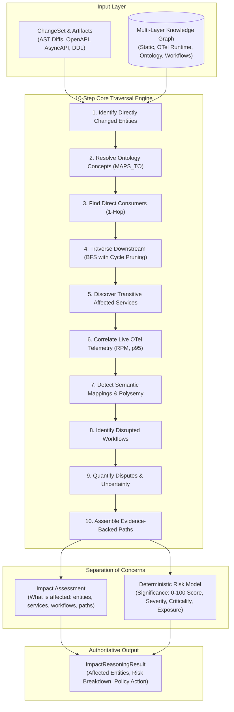

# ChangeScope Deterministic Impact Reasoning Engine

## 1. Executive Summary

The **ChangeScope Impact Reasoning Engine** computes the blast radius, affected services, disrupted business workflows, and risk significance of a proposed software change.

In accordance with ChangeScope architectural invariants, the engine operates on **deterministic graph algorithms** without delegating dependency inference or authoritative risk scoring to Large Language Models.

---

## 2. Multi-Layer Knowledge Graph Input

The engine queries an in-memory or projected dependency graph spanning multiple abstraction layers:

1. **Static AST Dependencies**: Class and function calls, imports, and client HTTP invocations extracted via Tree-sitter.
2. **Runtime-Observed Dependencies**: Verified live traffic edges with 7-day rolling call counts, error rates, p95 latencies, and exemplar trace IDs.
3. **API Contracts**: OpenAPI 3.x endpoints, HTTP verbs, request/response models, and status codes.
4. **Event Channels**: AsyncAPI message topics, schemas, publishers, and consumer subscriptions.
5. **Database Relationships**: SQL tables, foreign keys, columns, and mapped ORM models.
6. **Certified Ontology Concepts**: Canonical domain concepts (`BusinessConceptEntity`, URNs, synonyms, homonym distinctions).
7. **Business Workflows**: Multi-step business processes linked via `PART_OF_WORKFLOW` edges.
8. **Ownership & Permissions**: Team ownership (`OWNED_BY`) and authorization requirements (`REQUIRES_PERMISSION`).

---

## 3. The 10-Step Core Algorithm

| Step | Operation | Description |
| :--- | :--- | :--- |
| **1** | **Entity Identification** | Extracts altered endpoints, schema fields, database columns, or events from the ChangeSet before/after state. |
| **2** | **Concept Resolution** | Discovers mapped domain concepts (`MAPS_TO`, `TRANSFORMS_INTO`) linking entities to canonical business terms. |
| **3** | **Direct Consumer Lookup** | Identifies 1-hop callers, subscribers, and database readers pointing directly to the root entity. |
| **4** | **Downstream Traversal** | Executes Breadth-First Search (BFS) tracking hop distance, visited branches, and cumulative confidence. |
| **5** | **Transitive Cascade** | Traverses up to 5 hops downstream to map indirect consumers with path confidence decay ($\prod c_i$). |
| **6** | **Runtime Correlation** | Identifies edges verified by live OpenTelemetry traffic, incorporating RPM and p95 latency. |
| **7** | **Semantic Detection** | Identifies entities sharing polysemous concepts or affected by concept definition shifts. |
| **8** | **Workflow Identification** | Traverses `PART_OF_WORKFLOW` relationships to detect high-level business process disruptions. |
| **9** | **Uncertainty Quantification** | Flags uncertified candidate relationships and active `OntologyDispute` records. |
| **10** | **Path Assembly** | Constructs evidence-backed `ImpactPath` objects with citations for each impacted entity. |

---

## 4. Impact Categories

ChangeScope classifies affected entities into mutually distinct categories:

- **`DIRECT`**: 1-hop caller, subscriber, or reader consuming the changed entity.
- **`TRANSITIVE`**: Multi-hop consumer reached indirectly through an intermediary service.
- **`SEMANTIC`**: Affected by a change in business concept definition, unit shift, or polysemy collision.
- **`RUNTIME_OBSERVED`**: Edge confirmed by live OpenTelemetry distributed traces.
- **`WORKFLOW`**: Higher-level business process disrupted by failures in constituent services.
- **`PERMISSION`**: Affected by modified authorization boundaries or security scopes.
- **`UNKNOWN`**: Insufficient evidence or conflicting definitions.

---

## 5. Deterministic Risk Assessment Model

### 5.1 Separation of Impact and Risk

> **Core Invariant**: Impact describes **what may be affected** (entities, services, workflows, paths). Risk estimates the **significance of the possible failure** (score, breakdown, level).

A change affecting 10 internal analytics batch workers with safe additive fields has **high impact breadth** but **low risk significance**. Conversely, a breaking change affecting a single mission-critical checkout gateway has **low impact breadth** but **critical risk significance**.

### 5.2 Mathematical Formulation

The deterministic risk score $R \in [0, 100]$ is computed as:

$$R_{\text{raw}} = S_{\text{base}} + \sum_{i \in \text{Consumers}} \left( C_i \times \frac{1}{d_i} \times c_i \times U_i \times E_i \times F_i \times K_{\text{sem}} \right) + P_{\text{unc}}$$

$$R = \min(100, \max(0, \text{round}(R_{\text{raw}})))$$

Where:
- **$S_{\text{base}}$ (Base Severity)**: `BLOCKING` $= 50.0$, `WARNING` $= 25.0$, `INFO` $= 5.0$.
- **$C_i$ (Criticality)**: `TIER_1` $= 20.0$, `TIER_2` $= 10.0$, `TIER_3` $= 5.0$ ($+5.0$ if participant in affected workflow).
- **$d_i$ (Hop Distance)**: Decays impact by distance ($1.0$ at 1 hop, $0.5$ at 2 hops, $0.333$ at 3 hops).
- **$c_i$ (Path Confidence)**: Cumulative edge confidence $\prod_{\text{edge}} \text{conf}_{\text{edge}} \in (0, 1]$.
- **$U_i$ (Observed Usage)**: $\log_{10}(\text{call\_frequency\_7d} + 10.0)$.
- **$E_i$ (Exposure)**: `PUBLIC_INTERNET` $= 1.30$, `PARTNER_API` $= 1.15$, `INTERNAL_SERVICE` $= 1.00$, `RESTRICTED` $= 0.85$.
- **$F_i$ (Freshness)**: Live runtime verified $= 1.00$, Static-only $= 0.85$.
- **$K_{\text{sem}}$ (Semantic Confidence)**: Path semantic confidence factor ($0.5$ to $1.0$).
- **$P_{\text{unc}}$ (Uncertainty Penalty)**: $+10.0$ per unresolved dispute, $+2.5$ per uncertified candidate.

### 5.3 Risk Classification & Engineering Actions

| Risk Score ($R$) | Risk Level | Recommended Action | Policy Gate Behavior |
| :---: | :---: | :---: | :--- |
| $\ge 80$ | **`CRITICAL`** | `BLOCK_MERGE` | Automatically blocks PR/merge; requires architect signoff. |
| $60 - 79$ | **`HIGH`** | `REQUIRE_MANUAL_APPROVAL` | Requires designated service owner approval in GitHub/GitLab. |
| $35 - 59$ | **`MEDIUM`** | `RUN_CANARY_TESTS` | Enforces canary deployment or automated integration test suite. |
| $< 35$ | **`LOW`** | `PROCEED_WITH_MONITORING` | Merge allowed; telemetry monitored post-release. |

---

## 6. Graph Invariants & Safety

1. **Cycle Prevention**: The BFS traversal tracks visited nodes along each active branch and prunes redundant paths if a shorter path has already been traversed.
2. **Duplicate Edge Deduplication**: Redundant edges across protocols between identical source and target nodes are merged, aggregating traffic volume and retaining maximum confidence.
3. **Temporal Filtering (`valid_to`)**: Expired relationships are retained for audit history but strictly excluded from active impact traversal.
4. **Tenant Scoping**: All graph nodes and traversals are strictly bounded by `tenant_id`.

---

## 7. Performance & SLA Benchmarks

Benchmarked via `tests/benchmark/test_impact_engine_benchmarks.py`:

| Topology | Scale | SLA Threshold | Measured Execution Time |
| :--- | :--- | :---: | :---: |
| **Large Hierarchical Graph** | 1,000 nodes, 2,500 edges | $< 100$ ms | **50.44 ms** |
| **Dense Interconnected Mesh** | 100 services, 500 edges | $< 25$ ms | **3.69 ms** |
