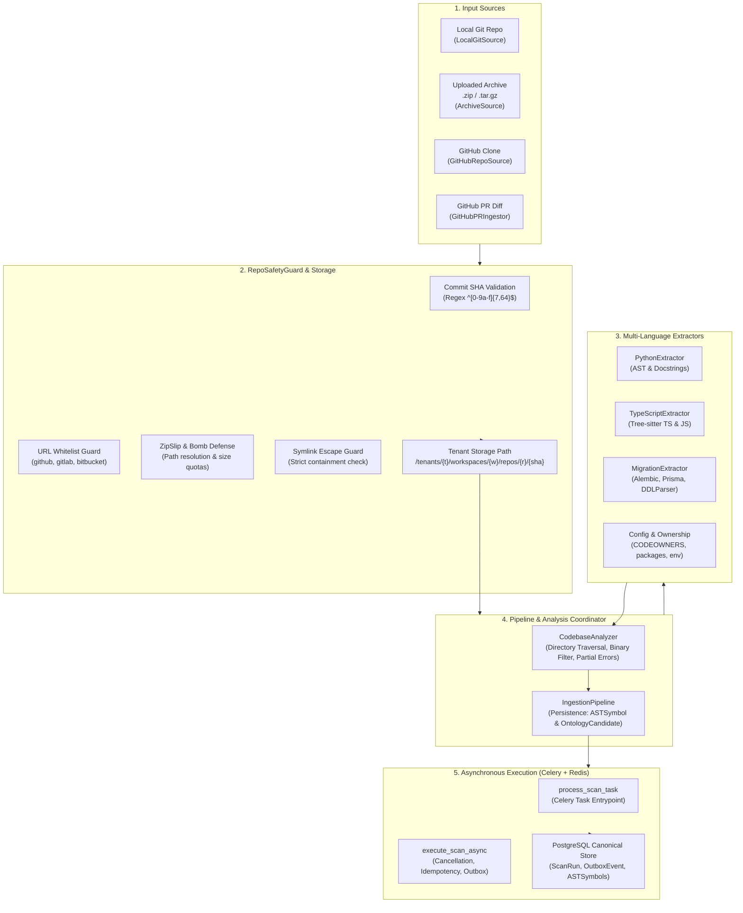
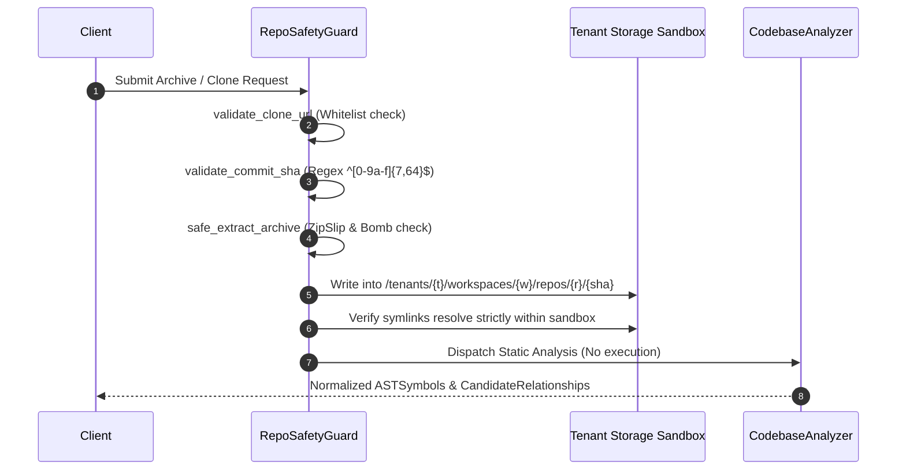

# ChangeScope Repository Ingestion Subsystem Architecture

## 1. Executive Summary & Purpose

The **Repository Ingestion Subsystem** is ChangeScope's foundational sensory layer. It ingests software repositories across multiple input sources, enforces rigorous sandboxing and cryptographic invariants, performs high-fidelity non-executing static analysis across Python, TypeScript, and JavaScript codebases, and extracts candidate ontology relationships backed by verifiable line-level citations.

---

## 2. Ingestion Architecture Overview



---

## 3. Input Sources

The subsystem supports four distinct input mechanisms, unified under the `BaseIngestionSource` abstraction:

| Source Type | Class | Description | Safety & Validation Controls |
| :--- | :--- | :--- | :--- |
| **Local Git** | `LocalGitSource` | Scans local filesystem repository path or git directory | Verifies directory existence and resolves commit SHA via `git rev-parse HEAD`. |
| **Uploaded Archive** | `ArchiveSource` | Ingests `.zip`, `.tar.gz`, `.tar.bz2`, or `.tar` archive streams | Decompression bomb limits (100 MB max archive, 10 MB max file, 10,000 max entries) and strict ZipSlip path traversal prevention. |
| **GitHub Remote** | `GitHubRepoSource` | Clones remote repository into isolated workspace | Host whitelist enforcement (`github.com`, `gitlab.com`, `bitbucket.org`), URL sanitization, non-interpolated argument vectors. |
| **GitHub PR** | `GitHubPRIngestor` | Ingests pull request metadata, unified diffs, and changed files | Parses unified diff hunks into line number sets; tags modified symbols for targeted blast-radius calculations. |

---

## 4. Multi-Language Static Analysis & AST Extractors

ChangeScope adheres strictly to **Static Code Analysis without Execution**: imported repository code is never evaluated, imported, or executed.

### 4.1. Supported Languages & Parsing Engines

1. **Python (`PythonExtractor`):**
   - Built on Python's native `ast` module.
   - Extracts: Classes, methods, functions, async handlers, docstrings, imports (`import x`, `from x import y`), exports (`__all__`), and call relationships.
   - Framework detection:
     - **FastAPI / Flask:** Decorator routing (`@app.get`, `@router.post`, `@bp.route`) with path parameters and HTTP methods.
     - **HTTP Clients:** `requests`, `httpx`, and `aiohttp` calls, reconstructing literal URL fragments from `ast.JoinedStr` f-strings with `{...}` dynamic placeholders.
     - **Event Producers:** Celery tasks (`.delay()`, `.apply_async()`) and Kafka message producers (`producer.send()`).
     - **Databases & ORM:** SQLAlchemy ORM models (`declarative_base`, `MappedColumn`, `ForeignKey`), table names, and session queries.
     - **Environment Variables:** `os.getenv`, `os.environ.get`, `os.environ[...]` with fallback detection.

2. **TypeScript & JavaScript (`TypeScriptExtractor`):**
   - Built on Tree-sitter using `tree_sitter_typescript` (`typescript` and `tsx` grammars).
   - Extracts: Classes, interfaces, functions, arrow functions, methods, imports, and exports.
   - Framework detection:
     - **Express / NestJS:** Routing methods (`app.get`, `router.post`), route handlers, and line ranges.
     - **HTTP Clients:** `axios.get/post` and `fetch(...)` calls with dynamic target detection and HTTP method inspection.
     - **Event Systems:** Node.js `EventEmitter` (`.emit()`, `.on()`).
     - **Databases & ORM:** Prisma schema models, TypeORM entity decorators, and Prisma client queries (`prisma.<model>.findMany/create`).
     - **Environment Variables:** `process.env.<VAR>` and `process.env['<VAR>']` with fallback inspection (`||`, `??`).

3. **Schema Migrations (`MigrationExtractor`):**
   - **Alembic:** Inspects `upgrade()` functions in Python scripts for `op.create_table`, `op.add_column`, `op.alter_column`, and column definitions.
   - **SQL Migrations (Prisma, Flyway, Raw DDL):** Integrates ChangeScope's `DDLParser` to parse `CREATE TABLE`, `ALTER TABLE ADD COLUMN`, `DROP COLUMN`, and constraints.

4. **Configs & Ownership (`ConfigAndOwnershipExtractor`):**
   - **CODEOWNERS:** Parses `.github/CODEOWNERS`, `docs/CODEOWNERS`, or root `CODEOWNERS` into path-pattern to owner list rules.
   - **Package Manifests:** Parses dependencies and versions from `package.json`, `pyproject.toml`, and `requirements.txt`.
   - **Configuration Files:** Discovers declared configuration keys from `.env.example` and `.env.template`.

---

## 5. Security & Isolation Invariants (`RepoSafetyGuard`)

To protect the ChangeScope execution environment against hostile or untrusted repositories:



1. **Zero Untrusted Execution:** No code from imported repositories is ever loaded into the Python runtime (`eval`, `exec`, or `importlib`).
2. **ZipSlip Traversal Defense:** All archive member file paths are validated against directory traversal escapes:
   - Rejects members containing `..` path segments or leading `/` / `\`.
   - Resolves target path and strictly verifies `str(target_path).startswith(str(sandbox_root))`.
3. **Decompression Bomb Protection:**
   - Enforces `MAX_ARCHIVE_SIZE_BYTES` (default 100 MB).
   - Enforces `MAX_FILE_SIZE_BYTES` (default 10 MB).
   - Enforces `MAX_ARCHIVE_FILE_COUNT` (default 10,000 files).
   - Enforces extraction timeouts.
4. **Symlink Escape Defense:** Symlinks resolving to paths outside the destination directory are strictly rejected.
5. **Shell Command Safety:** Shell execution is avoided; all external commands (`git clone`, `git rev-parse`) use explicit non-shell argument lists (`shell=False`) with sanitized arguments.
6. **Strict Tenant Storage Isolation:** Repositories are stored strictly in hierarchical, tenant-isolated paths:
   ```
   {STORAGE_BASE_DIR}/tenants/{tenant_id}/workspaces/{workspace_id}/repos/{repository_id}/{commit_sha}
   ```

---

## 6. Asynchronous Processing & Celery Lifecycle

The background worker operates via Celery backed by Redis, executing idempotent scans:

1. **Dual Entrypoints:**
   - `execute_scan_async`: Pure asynchronous implementation suitable for async test suites and FastAPI handlers.
   - `process_scan_task`: Synchronous Celery `@celery_app.task` wrapper executing `execute_scan_async` via `run_async()`.
2. **Idempotency & Duplicate Scan Detection:**
   - If a scan is requested for a repository and `head_sha` that was already completed, the worker detects the existing `ScanRun`, reuses its verified results, and links `reused_from`, preventing redundant compute.
3. **Cooperative Cancellation:**
   - Checks `scan.status == "CANCELLED"` prior to execution and after pipeline completion, aborting immediately without overwriting user cancellations.
4. **Partial Failure Tolerance:**
   - Syntax errors or oversized files in individual source files do not fail the overall scan. The `CodebaseAnalyzer` records them in `partial_errors` and continues analyzing the remaining codebase.
5. **Transactional Outbox Event Generation:**
   - Upon completion, the worker records an `OutboxEvent` with `event_type="scan.completed"` containing symbol and route counts.
   - On unhandled failures, the worker transitions `ScanRun.status="FAILED"` and creates a dead-letter `OutboxEvent` with `event_type="scan.failed"`.

---

## 7. Relationship Evidence & Deterministic Grounding

In strict compliance with ChangeScope Engineering Invariants:

> **Rule:** *Never claim a relationship has been proven merely because a filename or identifier matches.*

Every `CandidateRelationship` generated by `CodebaseAnalyzer`:
1. Identifies the specific source symbol and inferred target entity.
2. Designates the exact relationship type (`CALLS`, `IMPORTS`, `PRODUCES`, `CONSUMES`, `READS`, `WRITES`).
3. Carries an explicit `evidence` citation string documenting the file path, line number, and structural context.
4. Assigns a calibrated confidence score ($0.0$ to $1.0$) based on whether the reference was a direct static call or a dynamic string template.
5. Records whether the dependency is internal to the repository or external to a third-party library/service.
