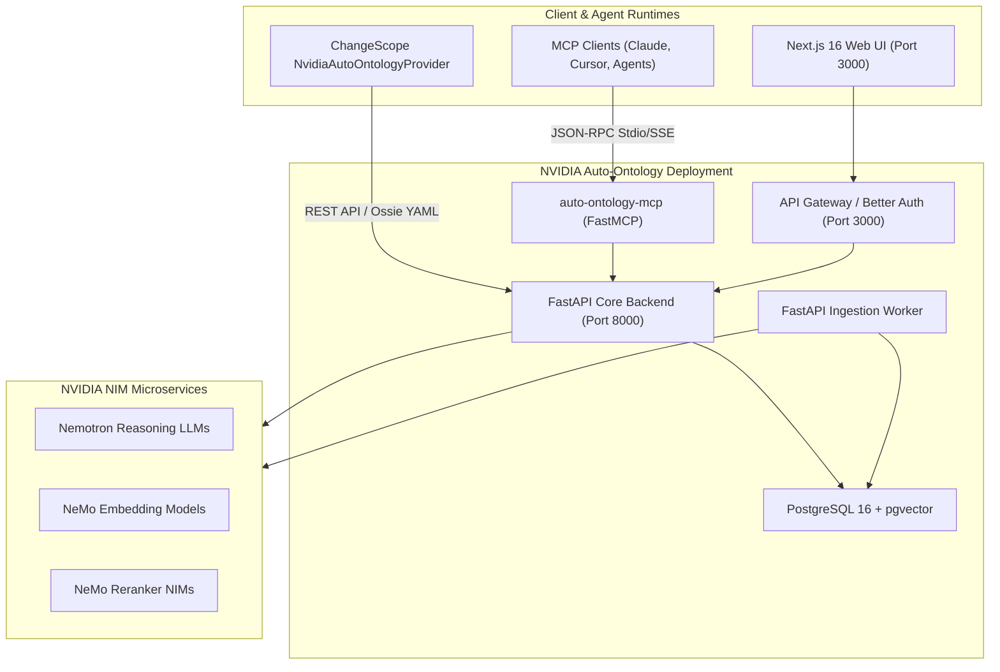
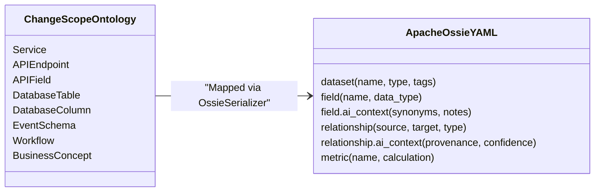
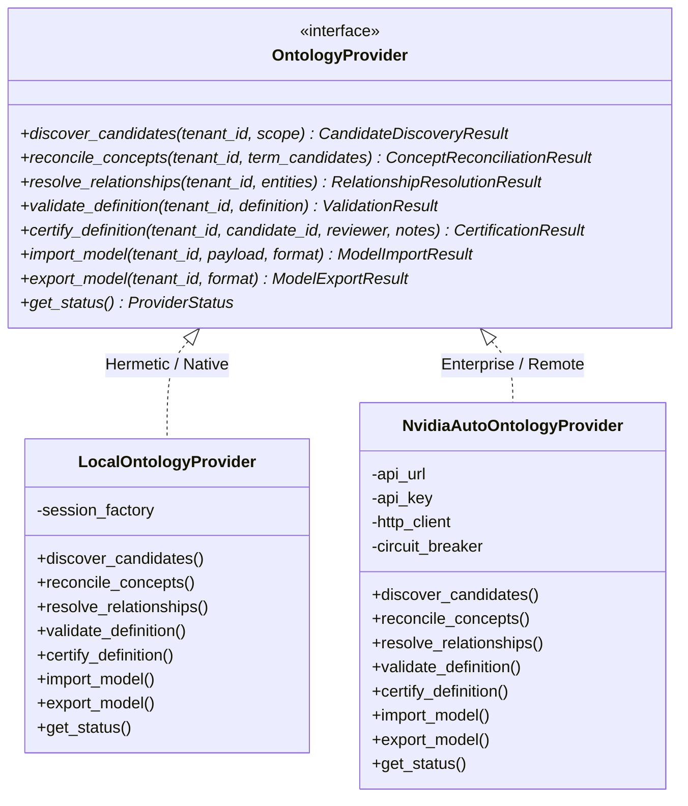

# NVIDIA Auto-Ontology Integration Layer & Provider Architecture

**Author:** ChangeScope Architecture Team  
**Status:** Approved & Implemented  
**Date:** November 2026  
**Document Version:** 1.0.0  

---

## 1. Executive Summary & Core Constraints

ChangeScope identifies hidden technical dependencies, semantic contract violations, and operational blast radius in distributed systems. To enrich ChangeScope's software knowledge graph with external enterprise semantic catalogs without introducing external dependencies into our core analysis loops, ChangeScope implements a pluggable **Ontology Integration Layer**.

### Core Operational Invariants:
1. **Never Depend on an External Service for Core Operation:**  
   ChangeScope's static AST analysis, contract parsers (OpenAPI, AsyncAPI, SQL DDL), and OpenTelemetry trace ingestion are the deterministic source of truth for software topology. NVIDIA Auto-Ontology must **never** be treated as the sole source of code-level dependencies.
2. **Zero-Credential Local Hermeticity:**  
   The entire application, all test suites, and all CI/CD benchmarks must execute deterministically using `LocalOntologyProvider` without requiring NVIDIA credentials, network access, or running external containers.
3. **No Repository Forking or Source Code Modification:**  
   The official upstream repository `https://github.com/NVIDIA/auto-ontology` is consumed strictly via documented, sanctioned integration interfaces:
   * **Apache Ossie YAML** semantic interchange standard (`.ossie.yaml` / `application/vnd.ossie+yaml`).
   * Authenticated HTTP REST APIs (`POST /api/model/import`, `POST /api/model/export`, `GET /api/health`, `GET /api/readiness`, `GET /api/terms`).
   * Read-only Model Context Protocol (MCP) server tools (`auto-ontology-mcp`).
4. **Preservation of Provenance, Ambiguity, and Human Certification:**  
   All imported or reconciled definitions must maintain explicit provenance, confidence scores, version histories, and dispute markers (`DISPUTED` status). Machine guesses are never auto-certified.

---

## 2. Upstream Repository Inspection (`NVIDIA/auto-ontology`)

A detailed technical audit of upstream repository `https://github.com/NVIDIA/auto-ontology` confirms the following architecture and capabilities:

### 2.1 Supported Deployment Approach
* **Web Gateway & UI:** Next.js 16 (React 19, TypeScript, Tailwind CSS 4) serving interactive chat, a visual data catalog, query analytics, and user settings. Manages session authentication via **Better Auth**. Defaults to port `3000`.
* **Core API Backend:** Python 3.12+ powered by **FastAPI** and **LangChain**. Handles ontology compilation, data source introspection, text-to-SQL generation, and semantic grounding. Defaults to port `8000`.
* **Ingestion Worker:** Secondary Python FastAPI service that profiles database tables, extracts column statistics, computes metadata descriptions, and generates vector embeddings.
* **Datastore:** **PostgreSQL 16+** with the **`pgvector`** extension. Stores relational metadata, semantic catalog definitions, and vector embeddings.
* **Inference Engine:** Relies on **NVIDIA NIM** (NVIDIA Inference Microservice) containers or cloud endpoints (e.g., `build.nvidia.com`) hosting Nemotron LLMs, embedding models, and rerankers.
* **Container Orchestration:** Deployed locally or in staging via Docker Compose (`docker-compose.yml`) or production Kubernetes manifests.

### 2.2 Authentication Requirements
* **API Key Authentication:** Supported via the `x-api-key: <key>` request header.
* **Bearer Token Authentication:** Supported via `Authorization: Bearer <token>` for OAuth2 / OIDC-backed deployments.
* **Session Cookies:** Managed by Better Auth for interactive web browser users.
* **Role-Based Access Control (RBAC):** Keys and tokens map to user permissions (e.g., read catalog, execute queries, modify definitions).

### 2.3 Verified REST APIs

| Endpoint | Method | Purpose | ChangeScope Utilization |
| :--- | :---: | :--- | :--- |
| `/api/health` | `GET` | Service liveness probe. | Health verification in `get_status()`. |
| `/api/readiness` | `GET` | Readiness probe (checks DB, pgvector, NIM). | Health check in `get_status()`. |
| `/api/model/export` | `POST` | Serializes catalog to Apache Ossie YAML. | Invoked by `import_model()` to pull remote definitions. |
| `/api/model/import` | `POST` | Ingests Apache Ossie YAML into catalog. | Invoked by `export_model()` to push ChangeScope ontology. |
| `/api/terms` | `GET` | Lists certified and candidate terms. | Term discovery and concept alignment. |
| `/api/terms/{id}` | `GET` | Retrieves full term schema, synonyms, SQL attributes. | Term reconciliation. |
| `/api/terms/search` | `POST` | Vector & keyword search across terms. | Invoked by `reconcile_concepts()`. |
| `/api/check-answerable`| `POST` | Checks if ontology answers specific question. | Validation of reachability. |
| `/api/query` | `POST` | Natural language text-to-SQL execution. | Optional analytical queries. |

### 2.4 Model Context Protocol (MCP) Capabilities
* Package `auto-ontology-mcp` is implemented using **FastMCP** in subdirectory `mcp/`.
* Exposes curated read-only tools to MCP clients:
  * `check_readiness`: Verifies deployment availability.
  * `search_terms`: Queries business definitions by keyword/intent.
  * `get_term`: Inspects specific term definitions and bound columns.
  * `get_term_columns` / `get_sql_attribute`: Inspects physical database columns bound to terms.
  * `describe_table`: Fetches table schema definitions.
  * `check_answerable`: Evaluates semantic coverage.
  * `ask_question`: Submits questions and returns generated SQL and tabular results.
* Can be launched via `uvx --from "git+https://github.com/NVIDIA/auto-ontology.git#subdirectory=mcp" auto-ontology-mcp`.

### 2.5 Model Import/Export Formats (Apache Ossie YAML)
* Auto-Ontology natively adopts **Apache Ossie (incubating)**—formerly known as *Open Semantic Interchange (OSI)*.
* Format: Declarative YAML document (`.ossie.yaml`, MIME `application/vnd.ossie+yaml`).
* Core Top-Level Blocks:
  1. `datasets`: Relational tables and logical views.
  2. `fields`: Row-level attributes, data types, and expressions.
  3. `relationships`: Explicit foreign key joins, one-to-many, and many-to-one join graphs.
  4. `metrics`: Business calculations and aggregates (sum, avg, count).
  5. `ai_context`: Rich metadata block carrying synonyms, semantic classifications, instructions, and disambiguation notes for LLMs.

### 2.6 Licensing & Upstream Boundary
* **License:** Apache License 2.0.
* **Permissibility:** Cleanly allows consuming APIs, creating adapter libraries, and exchanging Ossie YAML files without licensing conflicts or copyleft restrictions.
* **Invariant:** ChangeScope does not vendor, fork, or alter NVIDIA's internal repository.

---

## 3. ChangeScope Semantic Concept Mapping to Apache Ossie YAML

Auto-Ontology is natively designed for relational database schemas (tables, columns, joins). ChangeScope represents distributed software architectures (microservices, REST endpoints, AsyncAPI events, ORM entities, distributed traces, and canary workflows).

To achieve 100% loss-free interoperability through Apache Ossie YAML, ChangeScope defines a formal bidirectional translation:

### Detailed Translation Matrix

| ChangeScope CSEO Entity | Apache Ossie YAML Construct | Representation Details & `ai_context` |
| :--- | :--- | :--- |
| **`Service`** | `dataset` (logical) | `name: service_<name>` `type: logical` `ai_context.entity_type: Service` `ai_context.runtime: python/fastapi` `ai_context.tier: Tier-1` |
| **`APIEndpoint`** | `dataset` (interface) | `name: endpoint_<method>_<sanitized_path>` `type: interface` `ai_context.entity_type: APIEndpoint` `ai_context.http_method: POST` `ai_context.path: /api/v1/orders` |
| **`APIField`** | `field` (within endpoint dataset) | `name: <field_name>` `data_type: string/integer` `ai_context.entity_type: APIField` `ai_context.synonyms: [...]` |
| **`DatabaseTable`** | `dataset` (physical) | `name: <table_name>` `type: physical_table` `ai_context.database_engine: PostgreSQL 17` |
| **`DatabaseColumn`** | `field` (within table dataset) | `name: <column_name>` `data_type: uuid/bigint` `ai_context.is_primary_key: true` |
| **`EventSchema`** | `dataset` (event) | `name: event_<name>` `type: event_stream` `ai_context.entity_type: EventSchema` `ai_context.channel: commerce.orders.v1.created` |
| **`Workflow`** | `relationship` / `workflow` manifest | Represented as coordinated multi-dataset joins in `relationships` with `ai_context.workflow_id: <urn>`. |
| **`BusinessConcept`** | `ai_context` term / concept tag | Maps directly to `ai_context.business_concept: <urn>`, with `synonyms`, `bounded_context`, and `homonym_distinctions`. |
| **Relationships (`CALLS`, `WRITES`, `PERSISTS_AS`, `MAPS_TO`)** | `relationship` block | `name: <rel_type>` `source_dataset: <src>` `target_dataset: <tgt>` `ai_context.provenance: STATIC_CONFIRMED` `ai_context.confidence: 1.0` |

---

## 4. Provider Abstraction Architecture (`OntologyProvider`)

To ensure clean decoupling, testability, and adherence to Rule 7 (no duplicated domain logic across packages), ChangeScope defines the `OntologyProvider` abstract base class in `packages.shared.ontology.base`.

### 4.1 Interface Contract (The 8 Mandatory Methods)

1. **`discover_candidates(tenant_id: str, scope: dict[str, Any] | None) -> CandidateDiscoveryResult`**  
   Discovers uncertified entity and relationship candidates from code ASTs, specifications, or remote catalogs. Invariants: Candidates are flagged as `CANDIDATE` or `REVIEW_PENDING`; untrusted by default.
2. **`reconcile_concepts(tenant_id: str, term_candidates: list[dict[str, Any]]) -> ConceptReconciliationResult`**  
   Reconciles ambiguous field or table names against canonical business concepts. Separates synonyms from polysemic homonyms using `bounded_context`. Records competing interpretations as `DISPUTED`.
3. **`resolve_relationships(tenant_id: str, entities: list[dict[str, Any]]) -> RelationshipResolutionResult`**  
   Validates and resolves structural dependencies against the 15-relationship typing matrix with strict domain/range validation.
4. **`validate_definition(tenant_id: str, definition: dict[str, Any]) -> ValidationResult`**  
   Enforces structural, temporal, and semantic constraints (confidence ranges, evidence requirements, non-empty synonyms).
5. **`certify_definition(tenant_id: str, candidate_id: str, reviewer: str, notes: str | None) -> CertificationResult`**  
   Human certification workflow: promotes a candidate to `HUMAN_CERTIFIED` with exact `1.0` confidence and records reviewer audit metadata.
6. **`import_model(tenant_id: str, payload: str | dict[str, Any], format: str = "ossie_yaml") -> ModelImportResult`**  
   Ingests an external model in Apache Ossie YAML or CSEO JSON-LD, translating constructs into ChangeScope's canonical relational models.
7. **`export_model(tenant_id: str, format: str = "ossie_yaml") -> ModelExportResult`**  
   Exports ChangeScope's software knowledge graph as a valid Apache Ossie YAML document or CSEO JSON-LD payload.
8. **`get_status() -> ProviderStatus`**  
   Returns provider connectivity, health, circuit breaker state, latency, and active configuration.

---

## 5. Implementations

### 5.1 `LocalOntologyProvider` (Hermetic & Production-Ready)
* Runs natively inside the Python process using SQLAlchemy 2.0 and the canonical PostgreSQL / SQLite store.
* Zero network calls, zero third-party API keys required.
* Backs all unit tests, automated CI/CD pipelines, and local developer workflows.
* Includes full bidirectional Apache Ossie YAML serialization via `OssieSerializer`.

### 5.2 `NvidiaAutoOntologyProvider` (Enterprise Integration)
* Uses `httpx.AsyncClient` with declared connection timeouts (`10.0s`), read timeouts, and exponential backoff retries.
* Includes a **Circuit Breaker** (transitions from `CLOSED` $\rightarrow$ `OPEN` after consecutive failures, auto-recovering via `HALF_OPEN`).
* Integrates directly with verified endpoints:
  * Ingests upstream models via `POST /api/model/import`.
  * Pulls upstream models via `POST /api/model/export`.
  * Searches terms via `POST /api/terms/search`.
  * Validates service health via `GET /api/health` and `GET /api/readiness`.
* Strictly handles failure modes without crashing: if the remote service is unavailable, errors are caught, logged without credentials, and mapped to typed `ServiceUnavailableError` or degraded status.

---

## 6. What Works Locally vs. What Requires External Deployment

| Capability | LocalOntologyProvider | NvidiaAutoOntologyProvider | Requirement for NvidiaAutoOntologyProvider |
| :--- | :---: | :---: | :--- |
| **AST Code Extraction** | ✅ Fully Functional | ✅ Enriched | Local Tree-sitter parsers (native in monorepo). |
| **OpenAPI / AsyncAPI Ingestion** | ✅ Fully Functional | ✅ Enriched | Local YAML/JSON contract parsers. |
| **SQL DDL Migration Parsing** | ✅ Fully Functional | ✅ Enriched | Local SQLGlot DDL parser. |
| **OpenTelemetry Trace Ingestion**| ✅ Fully Functional | ✅ Enriched | Local OTel trace receiver and PII scrubber. |
| **Canonical Software Ontology** | ✅ Fully Functional | ✅ Fully Functional | Local PostgreSQL 17 / SQLite store. |
| **Relationship Matrix Validation**| ✅ Fully Functional | ✅ Fully Functional | Local `OntologyValidator`. |
| **SemVer Diff & Governance** | ✅ Fully Functional | ✅ Fully Functional | Local `OntologyGovernanceManager`. |
| **Apache Ossie YAML Import/Export**| ✅ Fully Functional | ✅ Fully Functional | Native `OssieSerializer` (PyYAML). |
| **Text-to-SQL Query Generation**| ⚠️ Not Applicable | ✅ Supported | Requires running NVIDIA Auto-Ontology backend + NIM Nemotron LLM. |
| **pgvector Semantic Search** | ⚠️ Fallback to Lexical | ✅ Supported | Requires PostgreSQL with `pgvector` extension and NeMo Embedding NIM. |
| **Remote MCP Catalog Tooling** | ⚠️ Local Mock Tooling | ✅ Supported | Requires `auto-ontology-mcp` service instance. |

---

## 7. Testing & Verification Plan

1. **Standard Automated Test Suite (`tests/integration/test_ontology_provider.py`):**  
   Executes against `LocalOntologyProvider` to test candidate discovery, concept reconciliation, relationship resolution, human certification, validation, and full bidirectional Apache Ossie YAML import/export.
2. **Opt-In Remote Integration Suite (`tests/integration/test_nvidia_ontology_provider.py`):**  
   Decorated with `@pytest.mark.skipif(not os.getenv("CHANGESCOPE_NVIDIA_AUTO_ONTOLOGY_URL"), ...)` to run only when an active Auto-Ontology endpoint and API key are configured. Also tests mock/offline failure recovery and circuit breaker behavior.
3. **Hermetic Benchmark Compliance:**  
   Guarantees that `python scripts/dev.py check-all` passes with 100% success without external dependencies.
