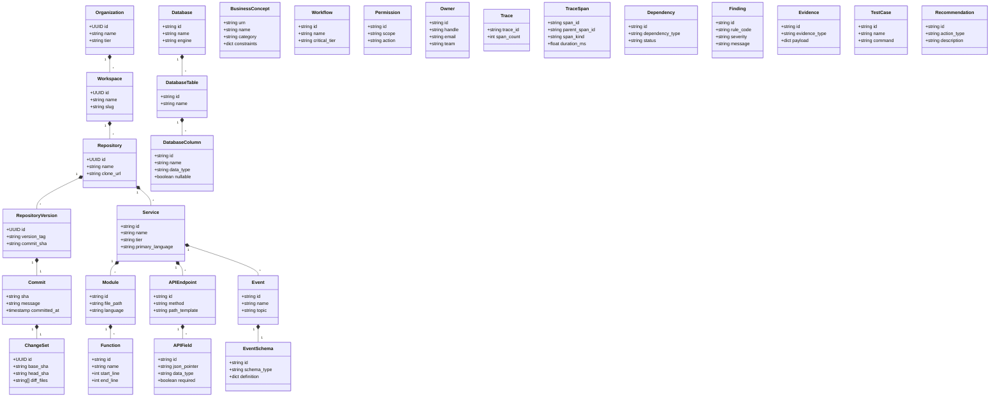
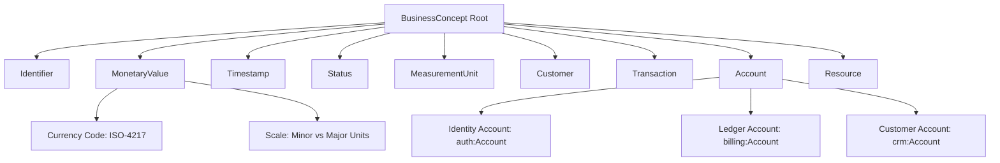

# ChangeScope Software Engineering Ontology (CSEO)
## Architecture Design Specification & Governance Framework

**Document Version:** 1.0.0  
**Status:** Approved Architecture Design Specification  
**Authors:** Principal Software Architect, Staff Knowledge Graph Engineer, Ontology Engineer  
**Target Systems:** PostgreSQL 17 (Canonical Store), Neo4j 5.20+ (Graph Projection), JSON-LD 1.1 (Interoperability)

---

## 1. Executive Summary & Design Principles

The **ChangeScope Software Engineering Ontology (CSEO)** provides a formal, versioned, and verifiable semantic model of distributed software systems. Unlike general enterprise knowledge graphs or Text-to-SQL business catalogs (such as NVIDIA Auto Ontology), CSEO is engineered specifically for **semantic change intelligence**: detecting hidden cross-service couplings, dangerous breaking changes, and cascading blast radii before Pull Requests are merged.

```
+----------------------------------------------------------------------------------------------------+
|                                    CSEO THREE-TIER SEMANTIC MODEL                                  |
|                                                                                                    |
|  [ LAYER 1: SOFTWARE REPOSITORY & SCM ]                                                            |
|  Organization -> Workspace -> Repository -> RepositoryVersion -> Commit -> ChangeSet              |
|                                                                                                    |
|  [ LAYER 2: CODE AST, SPECIFICATIONS & PERSISTENCE ]                                               |
|  Service -> Module -> Function -> APIEndpoint -> APIField                                          |
|  Event -> EventSchema | Database -> DatabaseTable -> DatabaseColumn                                |
|                                                                                                    |
|  [ LAYER 3: DOMAIN SEMANTICS, OBSERVABILITY & GOVERNANCE ]                                        |
|  BusinessConcept (MonetaryValue, Customer, Transaction, etc.)                                      |
|  Workflow, Permission, Owner, Trace, TraceSpan, Dependency, Finding, Evidence, TestCase            |
+----------------------------------------------------------------------------------------------------+
```

### Core Design Invariants:
1. **Deterministic Grounding:** Every entity and relationship must trace directly to verifiable physical artifacts (AST nodes, OpenAPI/AsyncAPI documents, SQL DDL migrations, or OpenTelemetry trace spans).
2. **Mandatory Provenance & Confidence:** Relationships cannot exist without explicit provenance (`STATIC_CONFIRMED`, `RUNTIME_OBSERVED`, `CONTRACT_CONFIRMED`, `ONTOLOGY_INFERRED`, `HUMAN_CERTIFIED`), an empirical confidence score ($[0.0, 1.0]$), and supporting evidence links.
3. **Temporal Validity Windows:** Relationships are historical and temporal, featuring `first_observed_at`, `last_observed_at`, `valid_from`, and `valid_to`.
4. **Disambiguation by Construction:** The ontology strictly distinguishes **synonymy** (different property names with identical real-world semantics) from **polysemy** (identical property names with incompatible domain meanings) using bounded domain contexts.
5. **No Blind Trust in Machine Inference:** Automated inferences remain in `CANDIDATE` or `REVIEW_PENDING` states until certified or corroborated. Conflicting mappings are preserved as `DISPUTED` rather than silently overwritten.

---

## 2. Core Ontology Entities (26 Entities)

The ontology formalizes 26 first-class entity types organized into four ontological domains:



### Entity Classification:
1. **Source Code & SCM:** `Organization`, `Workspace`, `Repository`, `RepositoryVersion`, `Commit`, `ChangeSet`.
2. **Architecture & AST Structure:** `Service`, `Module`, `Function`, `APIEndpoint`, `APIField`.
3. **Messaging & Relational Schema:** `Event`, `EventSchema`, `Database`, `DatabaseTable`, `DatabaseColumn`.
4. **Domain, Ownership & Policy:** `BusinessConcept`, `Workflow`, `Permission`, `Owner`.
5. **Observability & Evidence:** `Trace`, `TraceSpan`, `Dependency`, `Evidence`.
6. **Change Intelligence & Safety:** `Finding`, `TestCase`, `Recommendation`.

---

## 3. Relationships & Strict Provenance Semantics

### 3.1 The 15 Ontological Relationship Types

| Relationship | Permitted Source Node | Permitted Target Node | Description |
| :--- | :--- | :--- | :--- |
| `CALLS` | `Function`, `Service` | `APIEndpoint`, `Function` | Synchronous invocation (HTTP, gRPC, direct call). |
| `IMPORTS` | `Module` | `Module`, `Function` | Static code symbol import dependency. |
| `PRODUCES` | `Function`, `APIEndpoint` | `APIField`, `Event` | Emits or serializes an API response field or message. |
| `CONSUMES` | `Function`, `APIEndpoint` | `APIField`, `Event` | Ingests or deserializes an API parameter or event payload. |
| `MAPS_TO` | `APIField`, `DatabaseColumn` | `BusinessConcept` | Semantic grounding of code fields to business entities. |
| `READS` | `Function`, `Service` | `DatabaseColumn`, `DatabaseTable` | Queries database table or column. |
| `WRITES` | `Function`, `Service` | `DatabaseColumn`, `DatabaseTable` | Inserts, updates, or deletes database records. |
| `PERSISTS_AS`| `APIField`, `EventSchema` | `DatabaseColumn` | Direct storage mapping from wire contract to storage. |
| `PUBLISHES` | `Service`, `Function` | `EventSchema` | Asynchronous broadcast of event schema onto an event bus. |
| `SUBSCRIBES_TO`| `Service`, `Function` | `EventSchema` | Listening and consumption of an event topic. |
| `PART_OF_WORKFLOW`| `Service`, `APIEndpoint`, `Event` | `Workflow` | Association of technical components to user journeys. |
| `OWNED_BY` | `Service`, `Repository`, `Database` | `Owner` | Architectural and operational governance boundary. |
| `REQUIRES_PERMISSION`| `APIEndpoint`, `Function` | `Permission` | RBAC/ABAC authorization scope required to execute. |
| `DEPENDS_ON` | `Service`, `Module` | `Service`, `Module` | Composite or high-level architectural dependency. |
| `TRANSFORMS_INTO`| `APIField`, `DatabaseColumn` | `APIField`, `DatabaseColumn` | Data lineage and translation rule between versions. |

### 3.2 Mandatory Relationship Attributes (Rule 1 & Rule 2 Enforcement)

Every edge stored in PostgreSQL and projected into Neo4j must satisfy the following schema:

```json
{
  "id": "rel_c78e8b82-749e-5e26-a979-99c0bca80182",
  "tenant_id": "00000000-0000-0000-0000-000000000001",
  "type": "CALLS",
  "source_entity_id": "srv_order_service",
  "target_entity_id": "ep_payment_charge",
  "source_repo_version_id": "repo_ver_order_v2.4.1",
  "provenance": "RUNTIME_OBSERVED",
  "confidence": 0.98,
  "evidence_refs": [
    "evidence_otel_span_7a6b8c9d0e1f",
    "evidence_ast_callsite_checkout_py_L142"
  ],
  "first_observed_at": "2026-11-01T08:00:00Z",
  "last_observed_at": "2026-11-10T18:00:00Z",
  "valid_from": "2026-11-01T08:00:00Z",
  "valid_to": null,
  "status": "ACTIVE",
  "metadata": {
    "call_frequency_rpm": 420.5,
    "p99_latency_ms": 115.2,
    "http_method": "POST"
  }
}
```

### 3.3 Provenance Types & Confidence Constraints

1. `STATIC_CONFIRMED` ($\text{Confidence} = 1.0$): Discovered deterministically via Tree-sitter AST parsing.
2. `RUNTIME_OBSERVED` ($\text{Confidence} \in [0.70, 0.99]$): Verified empirically from OpenTelemetry distributed traces.
3. `CONTRACT_CONFIRMED` ($\text{Confidence} = 1.0$): Declared directly in OpenAPI, AsyncAPI, or SQL DDL specifications.
4. `ONTOLOGY_INFERRED` ($\text{Confidence} \in [0.40, 0.89]$): Computed via deterministic rule logic (e.g. transitivity).
5. `HUMAN_CERTIFIED` ($\text{Confidence} = 1.0$): Audited, verified, and signed off by a human domain architect.

---

## 4. Semantic Concept System & Disambiguation Engine

### 4.1 Canonical Semantic Concepts

To eliminate domain-level ambiguity, CSEO includes a formal dictionary of standard business concepts:



* **`MonetaryValue`**: Encapsulates currency (`ISO 4217`), scale (`cents` vs `dollars`), and rounding semantics.
* **`Identifier`**: Opaque string, UUIDv4, UUIDv7, ULID, or natural identifier.
* **`Timestamp`**: Unix epoch seconds, epoch milliseconds, or ISO-8601 with explicit timezone requirements.
* **`Status`**: Finite State Machine discrete value set (e.g., `OrderLifecycleStatus`).
* **`MeasurementUnit`**: Physical units (bytes, milliseconds, kilograms, percentage).
* **`Customer`**: External actor initiating system interactions.
* **`Transaction`**: Idempotent financial or workflow execution unit.
* **`Account`**: Bounded context entity (ledger, auth profile, or enterprise billing entity).
* **`Resource`**: Target asset subject to authorization or mutation.

### 4.2 Polysemy vs. Synonymy Resolution Architecture

| Semantic Hazard | Definition | ChangeScope Solution |
| :--- | :--- | :--- |
| **Synonymy (Aliases)** | Different names across services with identical semantic meaning. | Multiple `APIField` and `DatabaseColumn` nodes point via `MAPS_TO` to the same canonical `BusinessConcept` node with $1.0$ confidence. |
| **Polysemy (Homonyms)** | Identical property or class names carrying fundamentally different domain meanings. | Fields are scoped into bounded context sub-concepts (e.g., `urn:cseo:concept:auth:Account` vs `urn:cseo:concept:billing:Account`). False unification is blocked by ontological validation rules. |

```
SYNONYMY RESOLUTION:
  order-service.checkout_payload.customer_uuid   ---+
  billing-service.charge_request.account_holder   --+--> MAPS_TO --> urn:cseo:concept:CustomerIdentifier
  warehouse-service.shipment.recipient_id        ---+

POLYSEMY DISAMBIGUATION:
  auth-service.User.account      --> MAPS_TO --> urn:cseo:concept:auth:IdentityAccount (Credentials, MFA)
  billing-service.Order.account  --> MAPS_TO --> urn:cseo:concept:billing:LedgerAccount (Balance, Credit)
  crm-service.Client.account     --> MAPS_TO --> urn:cseo:concept:crm:EnterpriseAccount (ARR, Contacts)
```

---

## 5. PostgreSQL Entity Model (Canonical Single Source of Truth)

In accordance with ChangeScope Architectural Invariant 1 (PostgreSQL 17 is canonical), all ontology nodes, relationships, governance transitions, and historical diffs are persisted in PostgreSQL:

```
+----------------------------------------------------------------------------------------------------+
|                                    CANONICAL ONTOLOGY TABLES                                       |
|                                                                                                    |
|  1. ontology_namespaces         (Namespace isolation: cseo.core, cseo.fintech, custom)             |
|  2. ontology_versions          (SemVer version records, parent versions, changelogs)               |
|  3. ontology_entities          (All 26 entity types, tenant_id, canonical URN, metadata)           |
|  4. ontology_relationships     (All 15 relationship types, provenance, confidence, validity)       |
|  5. ontology_business_concepts (Canonical terms, synonyms, homonym distinctions, constraints)      |
|  6. ontology_concept_mappings  (Mappings between fields/tables and concepts, status, evidence)     |
|  7. ontology_candidates        (Machine-suggested entities/edges awaiting human review)            |
|  8. ontology_disputes          (Competing, unresolved semantic interpretations)                   |
|  9. ontology_diff_audits       (Auditable record of schema changes between versions)               |
+----------------------------------------------------------------------------------------------------+
```

---

## 6. Neo4j Graph Projection Model (Asynchronous Read Acceleration)

Neo4j projects the canonical state from PostgreSQL via transactional outbox events:

### Neo4j Node Labels:
`:Organization`, `:Workspace`, `:Repository`, `:RepositoryVersion`, `:Commit`, `:ChangeSet`, `:Service`, `:Module`, `:Function`, `:APIEndpoint`, `:APIField`, `:Event`, `:EventSchema`, `:Database`, `:DatabaseTable`, `:DatabaseColumn`, `:BusinessConcept`, `:Workflow`, `:Permission`, `:Owner`, `:Trace`, `:TraceSpan`, `:Dependency`, `:Finding`, `:Evidence`, `:TestCase`, `:Recommendation`.

### Neo4j Cypher Traversal & Multi-Hop Projection:
All Neo4j relationships project the 15 ontology verbs with standard properties:
`[:CALLS {id, tenant_id, provenance, confidence, valid_from, valid_to, status}]`

```cypher
// Multi-Hop Blast Radius Traversal Query:
MATCH path = (origin:APIEndpoint {id: $impacted_endpoint_id, tenant_id: $tenant_id})
  <-[:CALLS|CONSUMES|DEPENDS_ON*1..5]-(consumer:Service {tenant_id: $tenant_id})
WHERE ALL(r IN relationships(path) WHERE r.status = 'ACTIVE' AND r.confidence >= $min_confidence)
RETURN consumer.name AS consumer_service,
       length(path) AS distance,
       reduce(w = 1.0, r IN relationships(path) | w * r.confidence) AS cumulative_confidence,
       [n IN nodes(path) | labels(n)[0] + ':' + coalesce(n.name, n.id)] AS traversal_chain;
```

---

## 7. Ontology Governance Workflow

Machine inferences are treated as untrusted candidates until validated:

```
[ Automated Scanner (AST/OTel/Spec) ]
                   │
                   ▼
       ┌───────────────────────┐
       │   Status: CANDIDATE   │
       └───────────┬───────────┘
                   │
         Confidence >= 0.90?
        ┌──────────┴──────────┐
        │                     │
       YES                    NO
        │                     │
        ▼                     ▼
┌──────────────────┐  ┌───────────────────┐
│ REVIEW_PENDING   │  │ REJECTED / PRUNED │
└───────┬──────────┘  └───────────────────┘
        │
   Human Architect Review / Disputed Claim?
        ├──────────────────────┬──────────────────────┐
        ▼                      ▼                      ▼
┌──────────────────┐  ┌───────────────────┐  ┌──────────────────┐
│ HUMAN_CERTIFIED  │  │ DISPUTED          │  │ REJECTED         │
│ (Confidence=1.0) │  │ (Dual Candidates) │  │                  │
└──────────────────┘  └───────────────────┘  └──────────────────┘
```

1. **Unresolved Ambiguity Preservation:** When an automated tool identifies competing concepts (e.g. `payment_ref` mapping to both `TransactionID` and `AuthorizationCode`), both candidate mappings are persisted with status `DISPUTED`. Downstream semantic rules flag ambiguity rather than guessing.
2. **SemVer Ontology Releases:** Ontologies increment versions (`v1.0.0` $\rightarrow$ `v1.1.0` $\rightarrow$ `v2.0.0`). Breaking deletions or deprecations require a formal ontology migration audit.
3. **Automated Ontology Diff:** Computes added, modified, deprecated, and deleted entities and relationships between any two versions.

---

## 8. Reference 5-Microservice Architecture

The specification is verified against an interconnected enterprise microservice architecture:
1. **`auth-service`**: Exposes `/api/v1/auth/token` and `/api/v1/users/{id}`. Emits `UserRegisteredEvent`. Owns `users` table.
2. **`order-service`**: Exposes `/api/v1/orders`. Calls `payment-service` and `inventory-service`. Emits `OrderCreatedEvent`.
3. **`payment-service`**: Exposes `/api/v1/payments/charge`. Calls `auth-service` for token verification. Owns `payments` table.
4. **`inventory-service`**: Exposes `/api/v1/inventory/reserve`. Subscribes to `OrderCreatedEvent`. Owns `stock_levels` table.
5. **`notification-service`**: Subscribes to `OrderCreatedEvent` and `UserRegisteredEvent`. Emits notifications via third-party webhooks.
