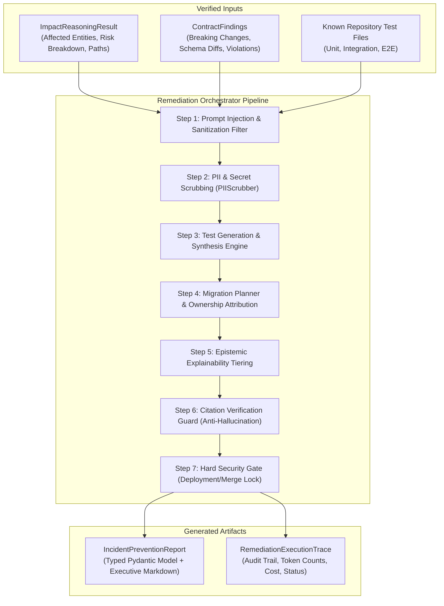

# ChangeScope Remediation Intelligence Layer

## 1. Executive Summary

The **ChangeScope Remediation Intelligence Layer** transforms verified impact findings and contract violations into actionable, evidence-grounded engineering guidance. Rather than merely alerting engineering teams to breaking changes, it automatically synthesizes:
1. Targeted regression tests with runnable code snippets.
2. Affected repository integration test suites.
3. Consumer-driven contract test assertions.
4. 5-phase zero-downtime API migration roadmaps.
5. Downstream service ownership escalation matrices.
6. Architectural compatibility mitigation patterns (e.g., Expand & Contract, Tolerant Reader).
7. Executive-ready incident-prevention reports.

---

## 2. Core Capabilities

### 2.1 Targeted Regression Test Generation
The system evaluates exact before/after schema deltas and synthesizes concrete regression test specifications:
- **Test Objective**: Clear statement of the regression scenario being guarded.
- **Preconditions**: Required fixture state, authentication tokens, and headers.
- **Test Inputs**: Concrete mock payload reproducing legacy client behavior (e.g., omitting newly required fields or sending obsolete enum values).
- **Expected Behavior**: Deterministic assertions (e.g., HTTP 400 Bad Request, fallback defaults).
- **Code Snippet**: Runnable `pytest` + `httpx` async test implementation.
- **Safety Status**: Every generated test is explicitly initialized with `requires_human_review = True` and `review_status = "PENDING_HUMAN_REVIEW"`.

### 2.2 Affected Integration Test Identification
Scans the repository for existing integration test files exercising impacted downstream communication paths, allowing CI pipelines to selectively run only relevant suites without full test execution overhead.

### 2.3 Consumer-Driven Contract Test Updates
For each impacted consumer service, ChangeScope recommends exact contract assertion additions (e.g., Pact specifications, OpenAPI validations) ensuring consumer builds fail locally before breaking deployments reach staging.

### 2.4 5-Phase Zero-Downtime Migration Roadmap
For high-severity contract modifications, the system formulates an **Expand & Contract** roadmap across 5 phases:
1. **Phase 1: Preparation (Additive Expansion)** - Deploy provider supporting both old and new schema variants.
2. **Phase 2: Dual-Write / Data Backfill** - Store dual formats; run asynchronous data reconciliation.
3. **Phase 3: Consumer Migration** - Coordinate client upgrades team by team with telemetry monitoring.
4. **Phase 4: Deprecation Notice** - Emit HTTP 299 warning headers and telemetry counters on legacy field usage.
5. **Phase 5: Cleanup & Decommission (Contract)** - Remove legacy schema fields once telemetry confirms zero calls.

### 2.5 Ownership Attribution & Escalation
Resolves responsible engineering teams, Slack alert channels, and escalation tiers for all impacted downstream services based on repository metadata and service registry information.

### 2.6 Compatibility Strategies
Provides architectural pattern recommendations tailored to the change type:
- **Expand and Contract (Parallel Run)**: For breaking column and property mutations.
- **Tolerant Reader**: For consumers vulnerable to closed-world schema parsing.
- **Dual Event Publication**: For breaking event payload evolutions across event buses.

### 2.7 Incident-Prevention Report
Compiles all findings, risk equations, explainability facts, and remediation steps into a human-readable Markdown report and typed JSON API response.

---

## 3. Epistemic Explainability Tiering

To prevent LLM hallucination and ensure auditability, ChangeScope enforces strict three-tier classification:

| Classification | Definition | Evidence Grounding |
| :--- | :--- | :--- |
| **`VERIFIED_FACT`** | Objective truths directly verified from repository ASTs, valid OpenAPI/AsyncAPI specifications, or active OpenTelemetry traces. | File paths, line numbers, and trace exemplar IDs. |
| **`INFERRED_FINDING`** | Derived knowledge resulting from graph traversal algorithms, transitive dependency chains, or ontology concept mappings. | Graph paths, hop counts, and cumulative confidence metrics. |
| **`RECOMMENDATION`** | Synthesized guidance, suggested test cases, migration plans, or policy actions. | Engineering rules and deterministic risk thresholds. |

---

## 4. Citation Verification Guard

The **Citation Verification Guard** validates every file path and trace identifier referenced in generated tests or advice against ground truth:
- If a citation refers to a file path not present in the repository scan, it is redacted with `[UNVERIFIED_PATH_REDACTED]`.
- If a trace exemplar does not exist in the OTLP trace buffer, it is flagged as unverified.
- Protects downstream developers from running hallucinated scripts or chasing phantom traces.

---

## 5. Security & Operational Invariants

In accordance with `AGENTS.md` and user requirements:

1. **Hard Gate: No Deployment or Auto-Merge (`can_deploy_or_merge = False`)**:
   Under no circumstances is the remediation intelligence layer permitted to merge pull requests, push commits directly to main, or trigger deployment pipelines. It remains strictly an advisory intelligence engine.
2. **Human Review Mandate**:
   All test cases and migration steps require human engineering review (`PENDING_HUMAN_REVIEW`).
3. **Adversarial Repository Handling**:
   Repository source files and comments are treated as untrusted user input. Any text matching common prompt injection vectors (`SYSTEM PROMPT:`, `IGNORE PREVIOUS INSTRUCTIONS`) is sanitized prior to processing.
4. **Zero Secret Exposure**:
   All outputs pass through the `PIIScrubber` to eliminate tokens, keys, passwords, and sensitive identifiers.
5. **Deterministic Token & Cost Accounting**:
   The `RemediationExecutionTrace` records total prompt tokens, completion tokens, execution duration in milliseconds, and estimated USD cost based on standard model pricing.
