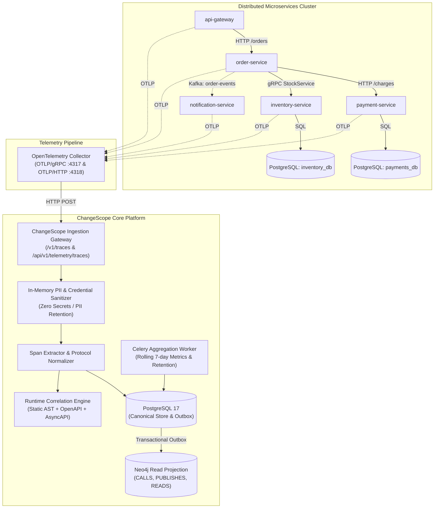

# Runtime Dependency Intelligence Architecture

## 1. Executive Summary

The **Runtime Dependency Intelligence** subsystem enables ChangeScope to discover and verify actual service-to-service, database, and asynchronous messaging communications in live, observed environments using standard **OpenTelemetry (OTel)** protocols.

By continuously correlating observed runtime telemetry with static AST symbol extraction and contract definitions (OpenAPI, AsyncAPI, SQL DDL), ChangeScope establishes a verifiable ground truth for distributed system dependencies, eliminating blind spots caused by dynamic routing, configuration drift, and unexercised fallback paths.



---

## 2. Ingestion Architecture

### 2.1 Standard OpenTelemetry Protocol (OTLP/HTTP) Endpoint

ChangeScope exposes standard OTLP/HTTP endpoints compliant with the OpenTelemetry specification:
- `POST /v1/traces` (Public / Collector Ingress with tenant resolution via `X-Tenant-ID` header or resource attributes)
- `POST /api/v1/telemetry/traces` (Authenticated tenant-scoped REST endpoint)

Incoming trace batches are processed asynchronously with linear streaming complexity $\mathcal{O}(N)$ where $N$ is the number of spans in the batch.

### 2.2 In-Memory PII & Credential Sanitizer (`PIIScrubber`)

In accordance with **Rule 5 of `AGENTS.md`** (*"Never expose secrets or credentials in logs or payloads"*), all trace spans pass through an in-memory sanitizer **prior** to database buffering or dependency extraction:

1. **Sensitive Key Redaction**:
   - Attribute keys containing `authorization`, `cookie`, `set-cookie`, `api_key`, `token`, `password`, `secret`, `private_key`, `client_secret` are immediately set to `[REDACTED_CREDENTIAL]`.
2. **Value Pattern Redaction**:
   - **JWT Tokens**: Masked to `[REDACTED_JWT]`.
   - **Payment Card Numbers (PAN)**: Masked to `[REDACTED_PAN]`.
   - **Social Security Numbers (SSN)**: Masked to `[REDACTED_SSN]`.
   - **Email Addresses**: Masked to `[REDACTED_EMAIL]`.
   - **URL Query Secrets**: Query parameters such as `?apiKey=...` or `&token=...` masked to `?[param]=[REDACTED]`.
3. **Database Statement Literal Scrubbing**:
   - SQL literals in `db.statement` are replaced with parameter placeholders (`'?'` for strings, `?` for numeric literals), ensuring customer data never persists in telemetry stores.

---

## 3. Dependency Discovery & Graph Construction

### 3.1 Trace Span Normalization

`SpanExtractor` standardizes varied OTLP encodings (both protobuf-json key-value wrappers and standard JSON dictionaries) into typed `NormalizedSpan` records:
- `trace_id`, `span_id`, `parent_span_id`
- `service_name` (extracted from `service.name` resource attribute)
- `kind` (`SERVER`, `CLIENT`, `PRODUCER`, `CONSUMER`, `INTERNAL`)
- `protocol` (`HTTP`, `GRPC`, `MESSAGING`, `DATABASE`)
- `status_code` (`OK`, `ERROR`, `UNSET`)
- Latency duration in milliseconds

### 3.2 Dependency Extraction Logic

`DependencyBuilder` reconstructs dependencies across 4 distinct communication topologies:

| Case | Scenario | Extracted Dependency Edge | Protocol |
| :--- | :--- | :--- | :--- |
| **Case 1** | Direct Parent-Child Span Pairing | Parent `CLIENT` in Service A calling Child `SERVER` in Service B within same trace | `HTTP` or `GRPC` |
| **Case 2** | Sampled Server Fallback | Outbound `CLIENT` span specifying `peer.service`, `net.peer.name`, or `server.address` (even when child server span was dropped by sampling) | `HTTP` or `GRPC` |
| **Case 3** | Database Spans | Spans with `db.system` (`postgresql`, `mysql`, `redis`, `neo4j`) | `DATABASE` (`db:<dbname>`) |
| **Case 4** | Messaging Producers / Consumers | Producer and Consumer spans matching on identical `messaging.destination` (Kafka topic, RabbitMQ queue) within the trace context | `MESSAGING` |

### 3.3 Statistical Aggregation & Exemplar Trace Linking

For each discovered dependency edge $(S_{caller}, S_{callee}, \text{Route}, \text{Protocol}, \text{Environment})$:
- **Call Frequency**: Rolling counter aggregated over the observation window.
- **Error Count**: Number of spans recording HTTP status $\ge 400$ or OTel error status.
- **P95 Latency**: 95th percentile duration calculated across observed samples.
- **Trace-Linked Evidence**: Captures exemplar `trace_id` and `span_id` providing direct deep-linking into Jaeger, Zipkin, or Grafana Tempo.

---

## 4. Multi-Layer Correlation Engine

The `RuntimeCorrelationEngine` connects runtime traffic to static AST dependencies, OpenAPI routes, and AsyncAPI channels.

### 4.1 Strict Absence Invariant

> **Operational Invariant**: Runtime observation is evidence of observed behavior, **never** proof that an unobserved dependency cannot exist.

Unexercised paths (such as disaster-recovery failover routines, quarterly financial batch processors, or seasonal endpoints) will rarely produce telemetry during short sampling windows. ChangeScope categorizes dependency alignment into three verified statuses:

1. **`OBSERVED_AND_STATIC_CONFIRMED`**:
   - Confirmed in both static AST codebase inspection and live OpenTelemetry traffic.
   - Confidence: $1.00$.
2. **`STATIC_ONLY`**:
   - Declared in code AST or OpenAPI specifications but unexercised during the telemetry window.
   - Preserved in graphs; never pruned or deleted.
   - Confidence: $0.85$.
3. **`RUNTIME_ONLY`**:
   - Observed in telemetry but no explicit static HTTP client call found in repository AST (e.g., dynamic proxy routes, reverse proxy ingress, or unanalyzed 3rd party SDKs).
   - Flagged for review to capture shadow or undocumented dependencies.
   - Confidence: $0.90$.

### 4.2 Software Ontology Integration

Discovered runtime relationships automatically produce `OntologyCandidate` records with provenance type `RUNTIME_OBSERVED`:
- `source_identifier`: Caller service entity
- `target_identifier`: Callee service or database entity
- `relationship_type`: `CALLS`, `PUBLISHES`, or `READS`
- `evidence_payload`: Includes exemplar trace ID, p95 latency, and call frequency

---

## 5. Five-Service Demo Environment

ChangeScope includes a production-grade 5-service distributed tracing simulator (`TelemetryTraceGenerator`):

```
[api-gateway]
    │  (HTTP POST /orders)
    ▼
[order-service] ────── (Kafka: order-events) ─────► [notification-service]
    │                 
    ├─── (HTTP POST /charges) ──────► [payment-service] ──► [(PostgreSQL: payments_db)]
    │
    └─── (gRPC ReserveStock) ───────► [inventory-service] ──► [(PostgreSQL: inventory_db)]
```

Integration tests in `tests/integration/test_runtime_dependency_intelligence.py` verify that all 5 services, 2 databases, and messaging channels are automatically mapped and exposed via `/api/v1/telemetry/runtime-graph`.

---

## 6. Background Aggregation & Neo4j Projection

1. **Buffered Ingestion**: Raw normalized spans are initially buffered in PostgreSQL table `runtime_trace_spans`.
2. **Asynchronous Worker Aggregation**: Celery task `apps.worker.tasks.aggregate_otel_traces_task` periodically executes rolling aggregations into `runtime_dependencies`.
3. **Transactional Outbox Event**: The task emits `OutboxEvent(event_type="runtime.dependencies.projected")`.
4. **Neo4j Read Projection**: The projection worker synchronizes aggregated edges into the graph store with full relationship metadata.
5. **Data Retention & Expiration**: Spans older than the retention threshold (default 7 days) are purged from `runtime_trace_spans` to maintain efficient storage bounds.
